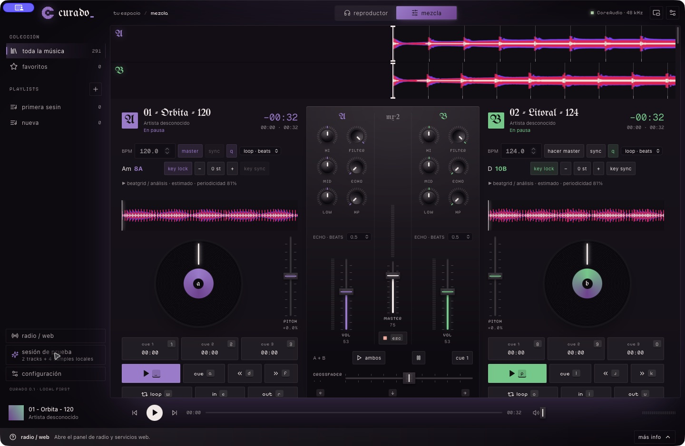
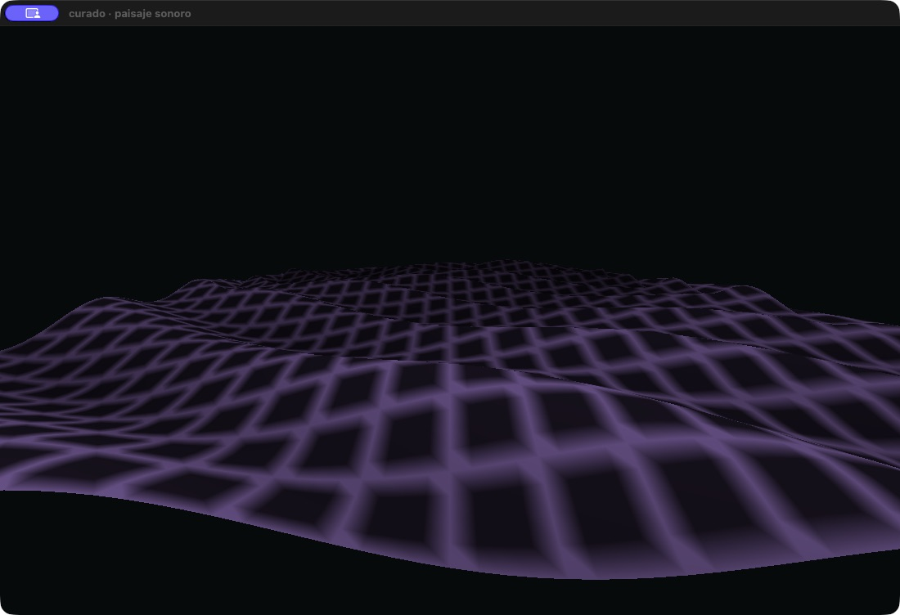
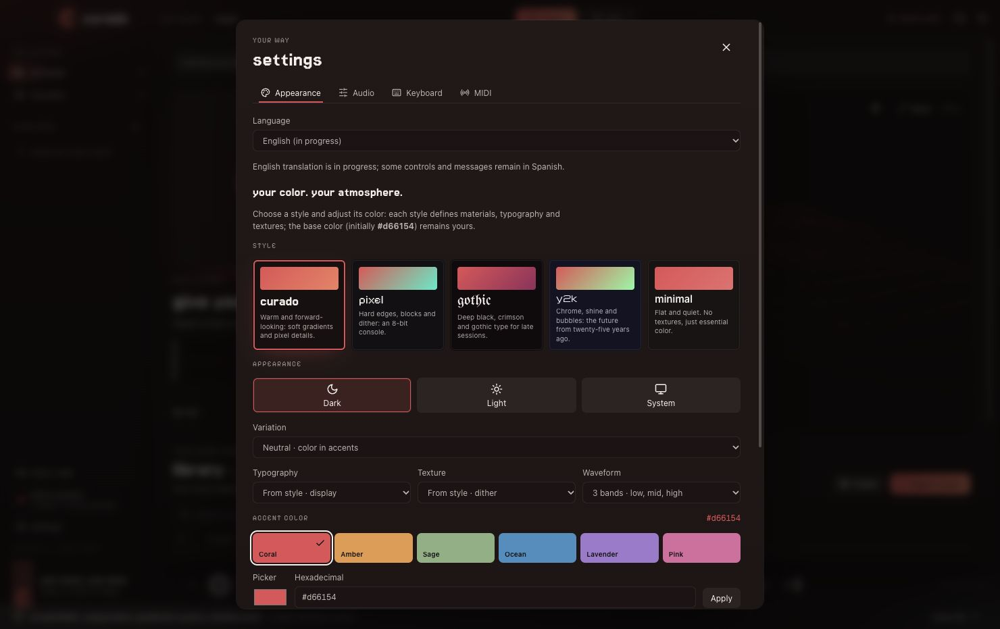

<p align="center"></p>
<h1 align="center">curado</h1>
<p align="center">Tu música. Dos decks. Espacio para jugar.<br>Un reproductor y mezclador de escritorio que se toca con el teclado.</p>
<p align="center"><a href="README.md">English</a> · <a href="docs/SETUP.md">Instalar con tu agente</a> · <a href="docs/README.md">Documentación</a> · Hecho por <a href="https://nu9ve.xyz">nu9ve</a></p>

Bienvenido. **curado** es un espacio para escuchar tu colección, probar una transición o armar una mezcla. Combina biblioteca, dos decks, mixer y cuatro pads de samples. Tus archivos se quedan donde están: curado no los mueve ni los modifica.



_Vista nativa de macOS con la sesión de prueba, en español y con estilo gótico. La documentación técnica está en inglés._

<details>
<summary>Más vistas</summary>



_El paisaje sonoro Metal en una ventana independiente de macOS (vista anterior del terreno)._



_Apariencia e idioma en la vista previa del navegador. La traducción al inglés sigue en desarrollo._

</details>

## Recorre la app

| Lugar                   | Qué puedes hacer                                                                                                              |
| ----------------------- | ----------------------------------------------------------------------------------------------------------------------------- |
| **Barra lateral**       | Recorrer la colección, favoritos y playlists; abrir radio, iniciar la sesión de prueba o configurar la app.                   |
| **Reproductor**         | Escuchar el deck A, usar una cola con repetición y ver el visual integrado que responde al audio.                             |
| **Mezcla**              | Cargar A y B, revisar sus waveforms y beatgrids, usar cues y loops, y mezclar con EQ, filtros, echo y cuatro pads de samples. |
| **Biblioteca**          | Buscar pistas locales, revisar el BPM y la tonalidad estimados, cargar una selección y organizar playlists.                   |
| **Configuración**       | Ajustar apariencia, salida y buffer, asignaciones de teclado y MIDI Learn.                                                    |
| **Footer y vista mini** | Controlar el deck A y el master; señalar o enfocar un control para ver su ayuda. La vista mini permanece encima.              |

La interfaz comienza en español; la opción de inglés está en desarrollo y algunos mensajes nativos permanecen en español. BPM, tonalidad y beatgrid son estimaciones que puedes corregir; SYNC sigue al deck master elegido y no inicia la reproducción. El audio de servicios web funciona separado de los decks locales.

> **0.1.0 · en desarrollo.** Compilación y pruebas automatizadas locales en Apple Silicon. Faltan validación de hardware en Windows/Linux y distribución firmada. Revisa el [estado](docs/STATUS.md) y los límites de abajo antes de depender de curado para una sesión.

## Qué puedes hacer

- **Escuchar:** biblioteca, búsqueda, favoritos, playlists, cola con repetición y vista mini siempre encima.
- **Mezclar:** dos decks, ocho hot cues por pista, loops por beats, sync de tempo/fase, EQ, filtros LP/HP y echo por beats.
- **Explorar la música:** BPM/key estimados, notación americana y Camelot, beatgrid editable, key lock y transposición ±12 semitonos.
- **Controlar:** teclado reasignable, MIDI Learn, feedback animado y ayuda contextual en el footer.
- **Personalizar:** cinco estilos, tu propio color, claro/oscuro/sistema y variantes de waveform.
- **Elegir la vista de mezcla:** alterna entre el diseño original de curado y una superficie inspirada en una cabina todo en uno; ambas usan los mismos controles de audio.
- **Visualizar:** abre Metal desde el reproductor en macOS y elige entre siete escenas, como la ciudad espectral y el osciloscopio circular. Ajusta brillo, reactividad, velocidad y color; arrastra para mover la cámara, usa H para ocultar controles y F para pantalla completa.
- **Trae tu USB:** los discos conectados aparecen en la barra lateral. Un USB de rekordbox muestra sus playlists, y las pistas cargan con sus grids, tonalidades y hot cues. Cualquier disco se puede explorar para buscar audio. curado solo los lee.
- **De vuelta a rekordbox:** guarda un `rekordbox.xml` con tus cues, loops y grids corregidos, e impórtalo desde rekordbox.
- **Abrir radio:** fractos y SoundCloud dentro de la app. Su audio web es independiente del mixer nativo.

Tu biblioteca y mezcla local funcionan sin internet. Los servicios web sí necesitan conexión.

## Dáselo a tu agente

Abre el repo en tu agente de programación y pega esto:

```text
Ayúdame a instalar curado en este equipo. Lee primero AGENTS.md y docs/SETUP.md.
Revisa mi sistema operativo y requisitos, instala desde los lockfiles y ejecuta
las comprobaciones indicadas. En macOS, compila e instala con bun run desktop:install.
No abras la app ni interrumpas una sesión de audio existente. Dime qué pasó las
pruebas y qué queda pendiente de verificar manualmente.
```

La [guía de instalación](docs/SETUP.md) reúne requisitos, diferencias entre sistemas, actualizaciones y problemas habituales. [AGENTS.md](AGENTS.md) explica los contratos que debe conservar cualquier cambio. No necesitas entender el motor de audio para probar la app.

## Instalar por tu cuenta

El flujo disponible aquí compila desde código; no se promete una descarga pública firmada. Necesitas Bun, Rust estable y los [requisitos de tu plataforma](docs/PLATFORMS.md). En Mac: Xcode completo, herramientas de línea de comandos, C++ y libclang.

```sh
git clone https://github.com/nu9ve/curado.git
cd curado
bun install --frozen-lockfile
bun run desktop:install
```

El instalador es **solo para macOS**. Deja `~/Applications/curado.app`, verifica la firma local y la registra para Spotlight/Raycast. No la abre ni cierra una instancia existente. Sal de curado antes de actualizar; el índice del launcher puede tardar. La firma es ad hoc, no una notarización para distribución.

Para desarrollo: `bun run desktop`. `bun run dev` solo muestra la interfaz en el navegador, sin audio nativo. [Windows y Linux](docs/PLATFORMS.md) tienen otros requisitos y aún necesitan validación física.

Después de cambiar código, `bun run desktop:install` recompila y actualiza tu Mac. `--no-build` solo reutiliza un bundle que acabas de compilar y verificar.

## Tu primera mezcla

1. Abre curado y elige **sesión de prueba** en la barra lateral. Genera dos pistas cortas y cuatro samples locales; no descarga música.
2. Cambia a **Mezcla**, reproduce A y B y mueve el crossfader.
3. Prueba un hot cue o un filtro. Señala cualquier control para ver su ayuda en el footer.
4. Importa tu música. Retirar una pista de la biblioteca nunca borra su archivo original.

| Acción                  | Deck A        | Deck B        |
| ----------------------- | ------------- | ------------- |
| Play/pausa              | Q, Espacio    | P             |
| Primer cue y reproducir | A             | L             |
| Hot cues 1/2/3          | 1 / 2 / 3     | 8 / 9 / 0     |
| Guardar cue             | Shift + 1/2/3 | Shift + 8/9/0 |
| Loop / IN / OUT         | W / E / R     | O / I / U     |
| Nudge −/+               | D / F         | J / K         |

Samples: `Z X C V`. Crossfader: `← ↓ →`. Pánico de audio nativo: `Esc` (no detiene audio web). Todo se reasigna en **Configuración → Teclado**. [Controles completos](docs/CONTROLS.md).

## Límites actuales

- Las pistas se cargan completas en memoria, unos 21 MiB por minuto: hasta unos **90 minutos por pista** y 3 GiB en total. Durante la sesión nada depende del disco.
- Los USB de rekordbox son de solo lectura, y los que solo tengan la base OneLibrary se ven como archivos normales. Los cues llegan a rekordbox con un XML que aún no se ha probado en rekordbox, así que primero respalda su biblioteca. Las pistas del USB sin un original seguro en la computadora llegan allí como otras pistas.
- El BPM y el grid son estimaciones medidas contra los de rekordbox y pueden fallar; revísalos antes de mezclar, sobre todo con periodicidad baja. La tonalidad aún no se ha medido con música real. Tempo y tono cambian al instante; al transponer, las notas muy graves pueden quedar algo altas.
- Playhead a 20 Hz; remuestreo y EQ todavía básicos. Los fundidos de loop y el limitador de salida pasan mediciones automáticas, pero aún falta probarlos de oído.
- Una salida estéreo, sin preescucha independiente por auriculares; recuperación de dispositivos manual.
- El navegador integrado necesita validación real de reproducción/login y layout. Su audio no responde a master, FX, sync ni pánico locales.

Siguientes prioridades en [Roadmap](docs/ROADMAP.md). Para contribuir, empieza en [AGENTS.md](AGENTS.md) y el [mapa de documentación](docs/README.md). Compilar no demuestra calidad auditiva ni estabilidad en directo.

## Licencia y créditos

Hecho por [nu9ve](https://nu9ve.xyz). **La licencia del código propio aún está pendiente.** Publicar el repo no equivale a dar permiso general para reutilizarlo; las dependencias conservan sus licencias.

La recomendación actual es MIT, que permite forks comerciales. Puedes combinar descargas gratis, donaciones y versiones oficiales de paga. Esa recomendación no aplica una licencia: la comparación y decisiones pendientes están en [Licensing](docs/LICENSING.md).
