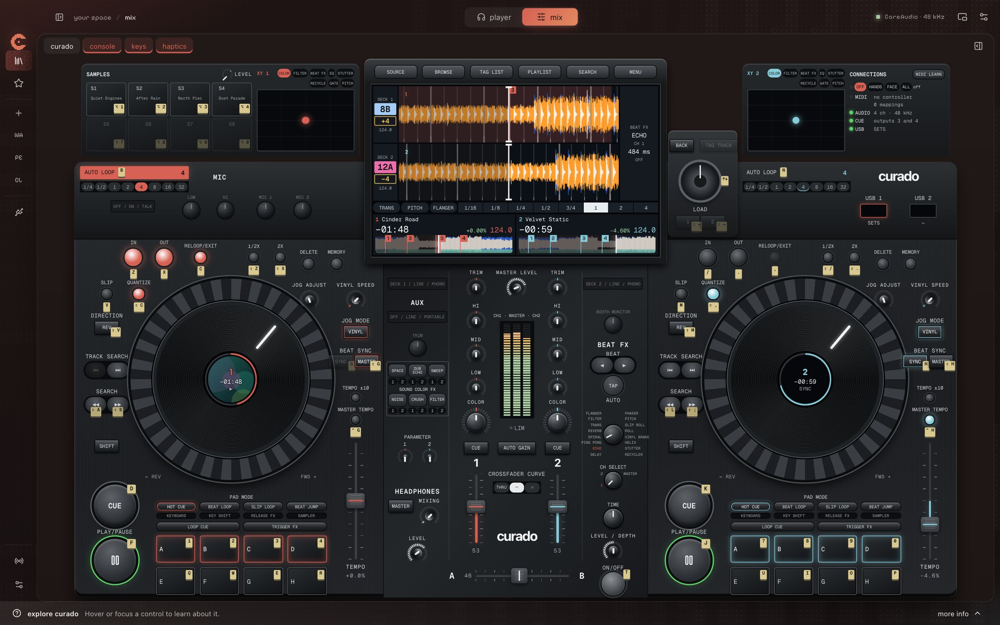
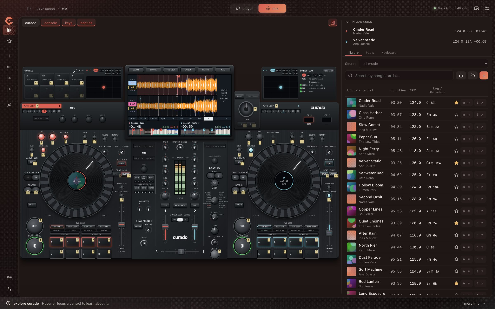
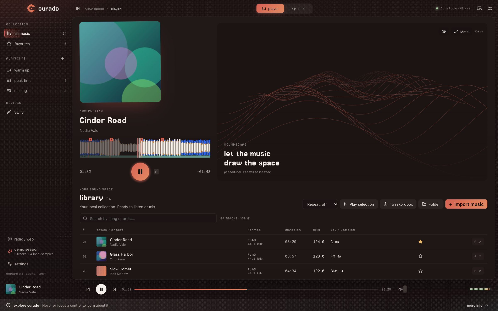
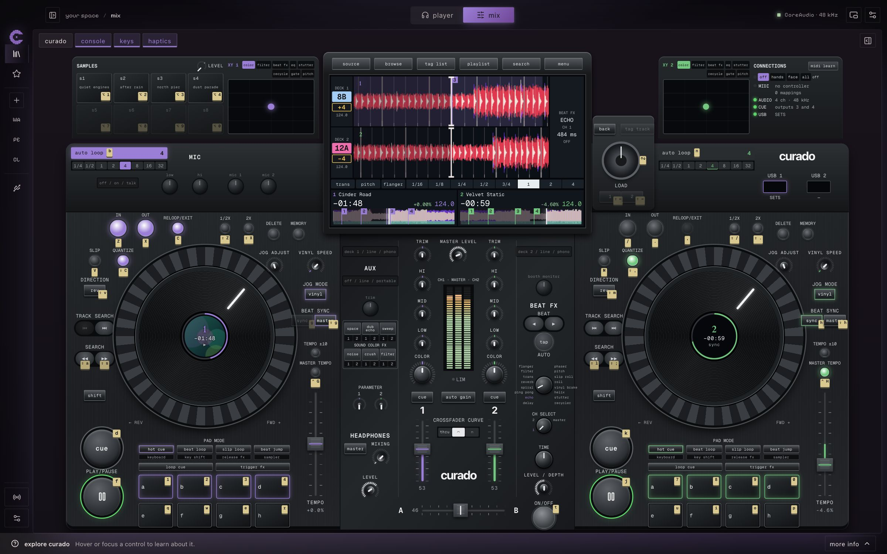
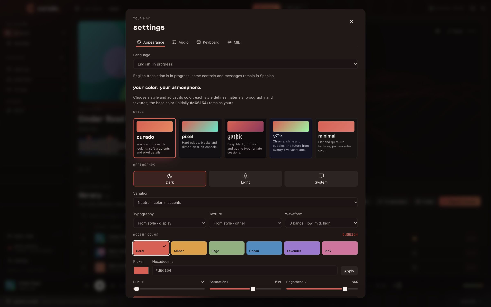

<p align="center"></p>
<h1 align="center">curado</h1>
<p align="center">Tu música. Dos decks. Espacio para jugar.<br>Un reproductor y mezclador de escritorio que se toca con el teclado.</p>
<p align="center"><a href="README.md">English</a> · <a href="docs/SETUP.md">Instalar con tu agente</a> · <a href="docs/README.md">Documentación</a> · Hecho por <a href="https://nu9ve.xyz">nu9ve</a></p>

Bienvenido. **curado** es un espacio para escuchar tu colección, probar una transición o tocar un set completo desde el teclado. Es una biblioteca de música y una consola de dos decks con la disposición de un sistema DJ todo en uno, con su propio motor de audio. Tu música se queda donde está: curado nunca mueve ni edita tus archivos.



_La consola con pistas inventadas. Cada etiqueta clara es la tecla de ese control._

## Qué trae

**Una consola para tocar.** Platos para hacer scratch, hot cues, slip, reversa, beat jump y pads de cues, loops, rolls, samples, cambios de tono y Release FX. Guarda hot cues que hacen loop, mantén un **TRIGGER FX** que sigue tu presión y presiona **AUTO LOOP** para hacer un loop sin marcar IN ni OUT, y elige su duración de 1/4 a 32 beats, incluso mientras suena.

**Efectos en cada canal.** Seis efectos de color y dieciséis de beat, incluidos Stutter y Recycler, distintos por canal y en el master.

**El teclado y tus manos a la vez.** Cada control muestra su tecla. Sigue tocando desde el teclado mientras arrastras un fader o giras un knob, reasigna lo que quieras o usa MIDI Learn. Mantén Option para llegar a todo el mixer con flechas. En un trackpad con Force Touch, los controles dan toques al moverse y, si presionas más fuerte, se mueven más fino.

**Tu USB de rekordbox tal como está.** Playlists, covers, grids, tonalidades y hot cues aparecen al conectarlo. curado solo lo lee, y puede devolver tus cues con un `rekordbox.xml`.

|                                                                                                         |                                                                                          |
| ------------------------------------------------------------------------------------------------------- | ---------------------------------------------------------------------------------------- |
|       |  |
| **Mezcla:** una sola pantalla fija, con biblioteca, herramientas y mapa de teclado en un panel lateral. | **Reproductor:** un deck, una cola con repetición y un visual que sigue la música.       |
|                         |           |
| **Tu color en cada estilo:** curado, pixel, gothic, y2k y minimal.                                      | **Configuración:** apariencia, salida de audio, teclado y MIDI.                          |

_Muestran la interfaz real en un navegador, con pistas inventadas y un sustituto del motor de audio. [Cómo se hacen](docs/README.md#pictures)._

<details>
<summary>El paisaje sonoro Metal</summary>


_Una ventana aparte en macOS con siete escenas, como la ciudad espectral y el osciloscopio circular. Esta imagen muestra una escena anterior de terreno._

</details>

## Todo lo que hace

- **Escuchar:** busca en tu biblioteca, ordénala por cualquier columna, guarda favoritos y playlists, usa una cola con repetición o cambia a una vista mini siempre encima. Los covers vienen de rekordbox o del archivo; si no hay, se ve un patrón con dither.
- **Mezclar:** dos decks con vista de consola o la clásica de curado, ocho hot cues por pista, loops por beats, sync de tempo y fase, EQ de tres bandas, filtros, trim, curvas de crossfader y ocho samples.
- **Iguala tonalidades de un vistazo:** la tonalidad de cada deck en color en la pantalla, con los semitonos hasta el otro, a una pulsación.
- **Preparar:** BPM, grid, compases y tonalidad estimados sobre toda la pista, en notación americana y Camelot. Corrígelos a mano. Key lock y transposición de ±12 semitonos. Las pistas cuyo tempo se mueve pueden seguir sus propios beats.
- **Audífonos:** con una salida de cuatro canales o más, el 3 y el 4 se vuelven un bus de cue con mezcla y nivel, más Touch Preview de la pista seleccionada.
- **Superficies extra:** dos pads XY con ocho modos, con el dedo, el puntero o, si quieres, por cámara, que está apagada hasta que la pidas y se queda en tu Mac. Cada mano mueve su lado, la cercanía es un tercer eje, y manos y cara juntas dan tres efectos.
- **Trae tu disco:** los discos conectados aparecen en la barra lateral. Un USB de rekordbox muestra sus playlists; en cualquier otro puedes buscar audio.
- **Personalizar:** cinco estilos, tu propio color, temas claro/oscuro/sistema y opciones de waveform.
- **Visualizar:** un visual reactivo en el reproductor y, en macOS, una ventana Metal con siete escenas. Ajusta brillo, reactividad, velocidad y color, arrastra la cámara, H oculta controles y F es pantalla completa.
- **Explorar:** radio fractos y SoundCloud dentro de la app. Su audio web va aparte del mixer nativo.

Tu biblioteca y mezcla local funcionan sin internet. Los servicios web sí necesitan conexión. No hay WebAudio que sustituya al motor nativo.

La interfaz comienza en español; el inglés está en Configuración y aún tiene algunos mensajes nativos en español. BPM, tonalidad y grid son estimaciones que puedes corregir.

> **0.1.0 · en desarrollo.** Compilación y pruebas automatizadas en Apple Silicon. Faltan validación de hardware en Windows y Linux y distribución firmada. Revisa el [estado](docs/STATUS.md) y [lo que conviene saber](#antes-de-empezar).

## Dáselo a tu agente

Abre el repo en tu agente de programación y pega esto:

```text
Ayúdame a instalar curado en este equipo. Lee primero AGENTS.md y docs/SETUP.md.
Revisa mi sistema operativo y requisitos, instala desde los lockfiles y ejecuta
las comprobaciones indicadas. En macOS, compila e instala con bun run desktop:install.
No abras la app ni interrumpas una sesión de audio existente. Dime qué pasó las
pruebas y qué queda pendiente de verificar manualmente.
```

La [guía de instalación](docs/SETUP.md) reúne requisitos, diferencias entre sistemas, actualizaciones y problemas habituales. [AGENTS.md](AGENTS.md) explica los contratos que debe conservar cualquier cambio. No necesitas entender el motor de audio para probar la app.

## Instalar por tu cuenta

El flujo disponible aquí compila desde código; no se promete una descarga pública firmada. Necesitas Bun, Rust estable y los [requisitos de tu plataforma](docs/PLATFORMS.md). En Mac: Xcode completo, herramientas de línea de comandos, C++ y libclang.

```sh
git clone https://github.com/nu9ve/curado.git
cd curado
bun install --frozen-lockfile
bun run desktop:install
```

El instalador es **solo para macOS**. Deja `~/Applications/curado.app`, verifica la firma local y la registra para Spotlight/Raycast. No la abre ni cierra una instancia existente. Sal de curado antes de actualizar; el índice del launcher puede tardar. La firma es ad hoc, no una notarización para distribución.

Para desarrollo: `bun run desktop`. `bun run dev` solo muestra la interfaz en el navegador, sin audio nativo. [Windows y Linux](docs/PLATFORMS.md) tienen otros requisitos y aún necesitan validación física.

Después de cambiar código, `bun run desktop:install` recompila y actualiza tu Mac. `--no-build` solo reutiliza un bundle que acabas de compilar y verificar.

## Tu primera mezcla

1. Abre curado y elige **sesión de prueba** en la barra lateral. Genera dos pistas cortas y cuatro samples locales; no descarga música.
2. Cambia a **Mezcla**, presiona `F` y `J` para reproducir cada deck y mueve el crossfader.
3. Presiona `B` para un auto loop de cuatro beats y `B` otra vez para salir. Señala cualquier control para ver su ayuda en el footer.
4. Importa tu música cuando quieras. Importar registra referencias a los archivos; retirar una pista nunca borra su original.

Cada mano toca su deck, con el mismo dedo para la misma función:

| Acción         | Deck 1    | Deck 2    | Con Shift   | Con Control  |
| -------------- | --------- | --------- | ----------- | ------------ |
| Play/pausa     | `F`       | `J`       |             |              |
| Cue            | `D`       | `K`       |             |              |
| Sync           | `G`       | `H`       | deck master | key lock     |
| Hot cues A–D   | `1 2 3 4` | `7 8 9 0` | guardar     | borrar       |
| Hot cues E–H   | `Q W E R` | `U I O P` | guardar     | borrar       |
| Auto loop      | `B`       | `N`       | más corto   | más largo    |
| Loop in / out  | `Z` `X`   | `/` `.`   | ½ / 2×      |              |
| Reloop         | `C`       | `,`       | quantize    |              |
| Nudge          | `A` `S`   | `L` `;`   | un beat     | cuatro beats |
| Slip           | `V`       | `M`       | reversa     |              |
| Beat FX on/off | `T`       | `Y`       |             |              |

`Espacio` detiene o inicia toda la mezcla. `↑ ↓` recorre la lista y `Shift + ← →` carga la pista seleccionada en el deck 1 o 2. `Control + ← ↓ →` mueve el crossfader. `Option` con el número de un hot cue dispara un sample. `Option` con la tecla de un control y flechas ajusta el mixer: ↑ arriba, ↓ silencio, ← → centro. `Esc` silencia el audio nativo, no el web. Las teclas siguen funcionando mientras arrastras un control o justo después de tocarlo. Se reasignan en **Configuración → Teclado**. [Controles completos](docs/CONTROLS.md).

## Antes de empezar

- Las pistas se cargan completas en memoria, unos 21 MiB por minuto: hasta unos **90 minutos por pista** y 3 GiB en total. Durante la sesión nada depende del disco.
- Los efectos están medidos. La reproducción y la mezcla se escucharon en el sistema del mantenedor, pero nada se comparó lado a lado con el hardware en el que se inspira.
- El bus de cue no se ha probado en una interfaz real de 4 canales, ni la cámara con una cámara real, ni los toques y la presión en un trackpad. Sin cuatro canales de salida no hay cue aparte en audífonos. La recuperación de dispositivos es manual.
- Los USB de rekordbox son de solo lectura, y los que solo tienen la base OneLibrary se ven como archivos normales. Los cues llegan a rekordbox con un XML que aún no se ha probado en rekordbox, así que primero respalda su biblioteca. Las pistas del USB sin un original seguro en la computadora llegan allí como otras pistas.
- BPM, grid y tonalidad son estimaciones medidas contra las de rekordbox y pueden fallar: revísalos antes de mezclar. Seguir el tempo es opcional por pista porque se activa en algunas estables. En una pista transpuesta, las notas muy graves pueden quedar algo altas.
- La reproducción y el login web dentro de la app aún necesitan validación real. El audio web no responde al master, los efectos, el sync ni el pánico locales.

Son prioridades activas, no opciones ocultas. Lo que sigue está en [Roadmap](docs/ROADMAP.md). Para contribuir, empieza en [AGENTS.md](AGENTS.md) y el [mapa de documentación](docs/README.md). Compilar no demuestra calidad auditiva ni estabilidad en directo.

## Licencia y créditos

Hecho por [nu9ve](https://nu9ve.xyz). **La licencia del código propio aún está pendiente.** Publicar el repo no equivale a dar permiso general para reutilizarlo; las dependencias conservan sus licencias.

La recomendación actual es MIT, que permite forks comerciales. Puedes combinar descargas gratis, donaciones y versiones oficiales de paga. Esa recomendación no aplica una licencia: la comparación y decisiones pendientes están en [Licensing](docs/LICENSING.md).
