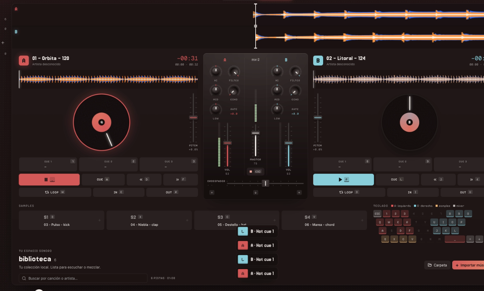

<p align="center">
  
</p>
<h1 align="center">curado</h1>
<p align="center">Your music. Two decks. Room to play.<br>A desktop music player and mixer, made for your keyboard.</p>
<p align="center"><a href="README.es.md">Español</a> · <a href="docs/SETUP.md">Install with your agent</a> · <a href="docs/README.md">Documentation</a> · Made by <a href="https://nu9ve.xyz">nu9ve</a></p>

Listen to your local collection, try a transition, or build a mix without leaving your keyboard. **curado** combines a music library with two decks, a mixer and four sample pads. Your music stays in its original location; curado never moves or edits the files.



_Mixer capture from a development session. The interface is currently in Spanish; this image does not show every feature in the latest build._

> **Early development · 0.1.0.** Built and tested automatically on Apple Silicon. Windows/Linux hardware validation, long-track streaming and release signing are still pending. See [current status](docs/STATUS.md) and [known limits](#before-you-start).

## Make yourself at home

- **Listen:** search your library, save favorites and playlists, play a queue with repeat, or switch to the mini player.
- **Mix:** two decks, three hot cues per track, beat loops, tempo/phase sync, EQ, LP/HP filters and beat echo.
- **Find the key:** estimated BPM and musical key in standard letter notation and Camelot, an editable beatgrid, key lock and ±12-semitone transposition.
- **Play by feel:** remappable keyboard controls, MIDI Learn, animated feedback and footer hints that explain the control you point to.
- **Make it yours:** five visual styles, your own accent color, light/dark/system themes and waveform options.
- **Explore:** fractos radio and SoundCloud inside the app. Their web audio is independent of the native mixer.

Local listening and mixing work offline. Web services need internet. There is no WebAudio replacement for the native engine.

## Install with your agent

Open this repository in your coding agent and paste:

```text
Help me set up curado on this computer. Read AGENTS.md and docs/SETUP.md first,
check my operating system and prerequisites, install from the lockfiles,
and run the required checks. On macOS, build and install the local app with
bun run desktop:install. Do not launch it or interrupt an existing audio session.
Report what passed and what still needs manual verification.
```

The [setup guide](docs/SETUP.md) includes prerequisites, platform differences, troubleshooting and local updates. The [agent guide](AGENTS.md) explains the contracts to preserve when changing code. You do not need to read the architecture to try curado.

### Bienvenido · ¿prefieres español?

curado es un espacio para escuchar tu música y jugar con la mezcla. Puedes darle este repo a tu agente y pedirle: **«Lee AGENTS.md y docs/SETUP.md, revisa los requisitos de mi equipo y ayúdame a instalar curado»**. Tienes la bienvenida, los pasos y un prompt completo en el [README en español](README.es.md).

## Install it yourself

This repository provides a source build workflow; the documentation does not promise a signed public download. You need [Bun](https://bun.sh), stable Rust and the [platform prerequisites](docs/PLATFORMS.md). On macOS, use full Xcode plus its command line tools; C++ and libclang are needed for pitch processing.

```sh
git clone https://github.com/nu9ve/curado.git
cd curado
bun install --frozen-lockfile
bun run desktop:install
```

The installer is **macOS only**. It builds and installs `~/Applications/curado.app`, verifies its local signature and registers it for Spotlight/Raycast. It does not launch the app. Quit an installed instance before updating; the installer will not stop it for you. Launcher indexing may take time. Local signing is ad hoc, not notarization.

For a development session on a supported build environment:

```sh
bun run desktop
```

`bun run dev` previews the interface in a browser **without native audio**. Windows and Linux setup/build instructions are in [Platforms](docs/PLATFORMS.md). To update a local Mac build after changing code, run `bun run desktop:install`; use `--no-build` only immediately after a verified build.

## Your first mix

1. Open curado and choose **sesión de prueba** in the sidebar. It generates two short tracks and four samples locally; nothing is downloaded.
2. Switch to **Mezcla**, play A and B, and move the crossfader to hear each side.
3. Try a hot cue, adjust a filter, or point to a control to read its footer hint.
4. Import your own music when you are ready. Import registers file references; removing library entries does not delete originals.

| Action                     | Deck A        | Deck B        |
| -------------------------- | ------------- | ------------- |
| Play/pause                 | Q, Space      | P             |
| Jump to first cue and play | A             | L             |
| Hot cues 1/2/3             | 1 / 2 / 3     | 8 / 9 / 0     |
| Save cue                   | Shift + 1/2/3 | Shift + 8/9/0 |
| Loop / IN / OUT            | W / E / R     | O / I / U     |
| Nudge −/+                  | D / F         | J / K         |

Samples: `Z X C V`. Crossfader: `← ↓ →`. Native audio panic: `Esc` (does not stop web audio). Remap controls in **Configuración → Teclado**. See [Controls](docs/CONTROLS.md) for sync, key lock, MIDI and recovery.

## Before you start

- Tracks are currently preloaded, capped at **96 MiB of decoded PCM per file**: roughly 4:22 at 48 kHz stereo. An hour-long track is not supported yet.
- BPM/key estimates need checking on real music. Pitch changes prepare a full clip in the background and can take time and extra memory.
- Playheads update at 20 Hz. Loops lack crossfades; resampling, EQ and the output ceiling remain basic.
- One stereo output; no independent headphone cue. Device recovery is manual.
- Web playback/login and the integrated browser layout still need real WebView validation. Web audio bypasses local master, FX, sync and panic.

These are active priorities, not hidden configuration switches. See [Roadmap](docs/ROADMAP.md) for what comes next.

## Build with us

The sound runs in a Rust engine (CPAL + Symphonia); Tauri and React handle the desktop interface. Decoding, analysis and pitch preparation stay outside the audio callback. The engine owns transport and position; the UI displays snapshots.

Start with [AGENTS.md](AGENTS.md), then [Setup](docs/SETUP.md) and the [documentation map](docs/README.md). Record evidence and limits with every change. Passing a build is not a listening test.

```sh
bun run check
bun run build
bun run format:check
cargo test --workspace --locked
cargo clippy --workspace --all-targets --locked -- -D warnings
```

## License and credits

Made by [nu9ve](https://nu9ve.xyz). **The project license has not been selected yet.** A public repository alone does not grant a general license to reuse its code. Dependencies retain their own licenses.

The current recommendation is MIT for permissive use, including commercial forks. Free downloads, donations and paid official editions can coexist; no license is applied by this recommendation. See [Licensing](docs/LICENSING.md) for the decision, dependency obligations and release checklist.
