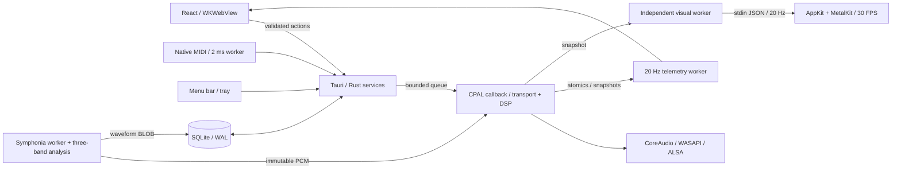

# Architecture and contracts

## Main flow

## Ownership and state

| Domain                         | Authority                                | Persistence                            | Frequency                                      |
| ------------------------------ | ---------------------------------------- | -------------------------------------- | ---------------------------------------------- |
| Transport, position, loop, DSP | `Renderer` and six `Deck` instances      | Temporary                              | Per sample/callback                            |
| Commands                       | `EngineHandle`                           | None                                   | Queue of 256; at most 64 consumed per callback |
| Library, favorites, playlists  | SQLite `Database`                        | WAL, foreign keys, schema v3           | On-demand worker                               |
| PCM and waveform               | Symphonia + `analysis`, outside callback | Temporary PCM; waveform BLOB in SQLite | One decode at a time                           |
| Playback queue                 | `playback::Queue`                        | Temporary; one prefetched clip         | 50 ms native worker                            |
| Library selection              | React                                    | Temporary                              | Interaction                                    |
| Keyboard shortcuts             | TypeScript registry, validated in Rust   | SQLite `settings`                      | Interaction                                    |
| MIDI mappings                  | `Midi`                                   | SQLite `settings`                      | Minimal input callback + 2 ms worker           |
| Visible audio state            | Engine snapshot                          | None                                   | 20 Hz; approximate consistency across fields   |
| Visuals                        | Canvas / Swift process                   | None                                   | At most 30 FPS                                 |
| Appearance                     | `theme-store.ts` / `preferences.rs`      | SQLite `settings`, theme v2            | Interaction                                    |
| Keyboard feedback              | `feedback.ts`, direct DOM                | None                                   | Per key, no React render                       |

Telemetry never causes the UI to re-emit an action. No PCM crosses IPC. Library UI is separate from telemetry consumers. Slider parameters coalesce for 16 ms; transport goes directly. Focused hotkeys follow DOM → IPC → Rust queue without waiting for React. They are not sample accurate; MIDI bypasses the WebView. Web Animations illuminate `data-action`/`data-key` controls, keycaps and the HUD in the input handler, without reading layout or awaiting the engine.

`ContextHelp` delegates `pointerover` and `focusin` once per mount, not `pointermove`. `hints.ts` resolves exact actions/current mappings and derives transport/routing diagnostics from snapshots. Help never controls audio, extrapolates position or writes preferences. Unspecified controls use their label/title and fallback text. Its fixed footer row expands the shell's reserved height and repositions notices.

## Waveform and UI rendering

`analysis::WaveformBuilder` consumes each decoded frame without a second pass: 50 bins/s, each `[peak, low, mid, high]` as linear `u8`, using the EQ's one-pole 220/2600 Hz splits. `analysis::encode` prepends `[1, 50, 0, 0]`; SQLite stores the BLOB (~48 KB for four minutes), returned by `track_waveform` as raw `ArrayBuffer` via `tauri::ipc::Response`, not JSON.

`get_library` excludes peaks. UI requests only displayed track waveforms, with a bounded 24-track FIFO cache. Pre-v3 tracks have `waveform NULL`; the next deck load fills it through non-overwriting `fill_waveform`, and UI requests it again.

Overview canvas repaints only for data, size or theme changes. Position, played area, loop and cues are DOM overlays using transforms/percentages. Detailed waveform pre-renders at 1 px/bin into 4096 px tiles (WebKit canvas limits); each snapshot uses one `drawImage` per visible tile, with an 8 s window and centered playhead. Platters use `position × 200°` (33⅓ rpm), derived from snapshots rather than a timer. Both remain at 20 Hz; see SESSIONS S2.

## Engine

Slots 0/1 are A/B; 2–5 are one-shots. Each deck uses immutable stereo PCM, fractional position and linear sample-rate interpolation. Rate multiplies the step. A/B pitch and key lock use equal-duration PCM prepared by a worker. Mono outputs downmix L/R; extra output channels are silent. Files with more than two channels are explicitly rejected.

Signal chain: source → one-pole split EQ at 220/2600 Hz → LP/HP → gain → beat echo using output BPM (feedback ≤.55) → A/B crossfader or .5 sample gain → master → ±.98 clamp. The ceiling prevents out-of-range samples but can distort; **it is not a mastering limiter**. Gains, crossfader, EQ, wet and filters are smoothed; manual transports transition over 128 frames. Loop boundaries can still be discontinuous.

Loading retains each slot's FX. A/B reset tempo to 1×, transpose to 0, key lock on and sync off. Loading the master disables follower sync. Device reconfiguration creates a new engine and unloads every slot; failure to create the new output preserves the previous one. Stream errors support manual recovery, not automatic reconnection.

`Cue(i)` atomically jumps and plays that slot; no clip means no start. `SetCue(i)` saves without transport changes. Seek/nudge preserve playing/paused state. A jump outside the loop disables it. `playBoth`, `pauseBoth`, `cueBoth(i)` use one queue entry and apply to A/B before the first sample of the same block, leaving samples/gains/crossfader/master alone. Player mode blocks them in native and keyboard policy. Individual commands may land in different blocks. Musical sync/deferred cues are separate from explicitly linked block-boundary transport.

## Musical analysis and control

`music.rs` analyzes at most 90 s after decoding: attack envelope, autocorrelation and period refinement for BPM/offset; FFT/chroma/major-minor profiles for key. This is an additional offline pass, separate from waveform construction during decoding. It does not detect bars/downbeats, variable tempo or modulation. Periodicity/margin indicators are not calibrated probabilities; silence or insufficient evidence can return unknowns.

Versioned analysis with a manual flag lives in `settings["music:<id>"]`, without a schema-v3 migration. Library data includes it optionally; older tracks analyze on load/reanalysis. Loading preserves saved corrections. Editing accepts registered IDs and validated values, saves to SQLite and updates metadata for every renderer slot holding the track. Original tags are never written.

Each deck starts with Q enabled and has beat-loop length and sync state. Master guides tempo/phase; follower derives rate from both BPMs. Key-locked tempo changes await preparation; if both need new PCM, one entry applies the whole batch before a block. Sync never starts transport. With SYNC+Q, follower cues execute per sample at the next master beat; other manual transport reevaluates phase. Follower pause, panic, linked transport, mode/master/metadata/load changes cancel pending cues. Master EOF also cancels waiting cues. There is no JS musical clock.

`curado-tuning` retains up to two original sources and prepares up to two results with **signalsmith-stretch =0.1.3 (MIT)**. Factor is `2^(semitones/12) / rate` with key lock, otherwise `2^(semitones/12)`. Output keeps sample rate/frame count, discarding both halves of processor latency. C++/FFT/allocations stay in this worker. Rapid controls coalesce for 100 ms before PCM allocation; processing checks cancellation per block. Previous audio continues until replacement is ready.

Batches carry load tickets and tuning revisions: reloading even the same ID invalidates old jobs. Callback validates the whole batch and retires replaced/rejected clips, reserving at least two free `retired` slots and never freeing PCM. Block-end acknowledgement includes discarded batches so a still-current request can retry. Preparation errors are visible and explicitly retryable. Output changes invalidate jobs by generation. PCM installation preserves position, playing state, cues and FX.

Additional cost: up to **192 MiB** cached original sources plus **192 MiB** prepared results, beyond existing/retired clips. This is neither streaming nor a global memory budget. Echo preallocates 8 s per slot (~18 MiB for six slots at 48 kHz), covering up to two beats across the tempo range. HP/LP, wet and delay time are smoothed; changing echo time may sweep pitch. HP adds no buffering. Transient/spectral quality and loop boundaries need real listening/corpus validation.

## Memory and real time

- PCM ≤96 MiB per clip; six resident clips can total 576 MiB, excluding UI, temporary and retired memory.
- At most two pending loads. Import/load serialize; a large import can delay new loads without blocking existing playback.
- Loads create PCM outside callback. Replacement moves the old reference into `retired` (capacity 256); a worker reclaims every 50 ms.
- A full reclamation queue pauses command consumption until space returns; queues do not grow.
- A strict global memory/byte reclamation budget and streaming remain P0.
- No DB, filesystem, locks, logging, Tauri events or buffer allocation in callback. DSP/delay buffers are prepared at engine creation.
- Atomic snapshots are best effort; 20 Hz telemetry is not a musical sync clock.

## Queue and modes

“Escuchar selección” sends filtered IDs in playlist/library order. After observing playback, the worker detects EOF, decodes the next track and sends load/play. Loading can leave a gap: not gapless. Manual A load cancels queue; normal pause preserves it; panic/mode change cancel it. Repeat modes: off/one/all.

Player uses A with crossfader left and pauses B/samples on entry. Mix centers the crossfader. Rust owns and persists mode, filtering UI/keyboard/MIDI identically. One audio command applies crossfader/pauses together. Mode changes must not recreate the device.

## Library and security

Native file/folder pickers. Recursive import does not follow symlinks, caps batches at 2000 files, validates by decoding and returns at most 30 individual error messages. Paths are canonicalized/deduplicated. Originals never move or get deleted. Loads take registered library IDs, not JS paths. No video tags or native remote streaming.

SQLite tables: `tracks`, `playlists`, `playlist_tracks`, `settings`; foreign keys and cascades remove relationships only. Initial schema creation is transactional and rejects future versions. v1→v2 preserves IDs/playlists/favorites, checks relationships and uses AUTOINCREMENT to prevent ID reuse. v2→v3 transactionally adds `tracks.waveform BLOB`; legacy `peaks` writes `'[]'`. v4+ is rejected without modification. Future migrations must preserve references and test rollback/backup.

Trusted frontend has local CSP, no remote scripts or generic shell/file API. Fonts are bundled; client-generated dither `data:` PNGs are allowed by `img-src`. Window permissions cover drag/theme/background and mini `set-size`, `set-min-size`, `set-always-on-top`; no generic window/WebView creation permission. Rust validates app commands. Codec fuzzing, dependency audit and malicious-file task limits remain pending.

## MIDI and visuals

midir uses CoreMIDI/WinMM/ALSA. Input callback copies three bytes into a queue of 256. Worker handles at most 64 messages every 2 ms, learns device/channel/type/number and sends the same engine actions. CC normalizes parameters (EQ 0–2, unity at CC 64); buttons trigger on Note On or CC ≥64. No MIDI Clock, relative encoders, SysEx or feedback yet.

Metal is a separate process. App extracts a Swift helper into cache; it receives RMS, peak and a 64-sample scope, never complete PCM. Blocked stdin only stalls the visual worker. The helper offers a terrain mesh plus orbit, tunnel and ribbon shaders; a native selector and glow slider affect only the helper and reset when it closes. Scenes use the shared accent, RMS and waveform; the glow is procedural rather than a post-processing bloom. There is no FFT/true band separation. Drawing is bounded to 30 FPS and hidden/minimized skips drawing. Helper exits on window close/stdin close. Distribution requires replacing extraction with a signed in-bundle helper.

## Isolated web services

`web.rs` creates a child WebView in main via Tauri's unstable `Window::add_child`, using fixed fractos/SoundCloud URLs. React reserves its area and syncs logical bounds through ResizeObserver/resize/scroll; Rust rejects negative/nonfinite/empty/oversized rectangles. Serialized React operations and an independent native gate do not touch audio. Switching service or unmounting (library/mini) closes it. Settings/playlist dialogs only hide it temporarily while playback continues. Web audio bypasses engine/panic.

HTTPS exact-host policy includes widgets; incognito, popups/downloads denied. No script injection or PCM bridge. `app_commands.rs` registers every app command in AppManifest to generate permissions. Capability selects only **webview main**, omitting `windows` (which would grant its children permissions too). Handler additionally rejects other labels. Local CSP/core permissions unchanged, no remote grants or generic JS creation. Tray/single-instance use Window, since WebviewWindow no longer represents main while children exist. Tests cover permission selection/wiring/URLs/bounds, not real layout/focus/player compatibility. See ADR-012.

## Persistent cues, modes and themes

Clips share track `CueState`: three values plus atomic revision. Saving a cue allocates nothing and performs no IO; callback updates seconds. Both decks share cues for the same track. Independent `curado-autosave` worker (50 ms) saves changed `settings["cues:<id>"]`, marks saved revision only after success, retries failures and publishes `persistenceError`. Normal shutdown flushes. Loops/session positions remain temporary.

Within 15 s of EOF, prefetch worker decodes next track under `decode_gate` without holding queue/output, storing `Queue::prefetched`. `advance` uses it if ID matches. Repeat-one seeks to 0. Stopping queue releases the clip on the worker. Gap becomes roughly one tick (≤50 ms) plus callback acknowledgement, still not gapless; at most one extra ≤96 MiB clip.

`load_track` waits for callback ticket acknowledgement before reporting ready, with a two-second timeout/recoverable error if output is not processing. Enqueueing PCM alone is not success; demo pads cannot appear ready under backpressure prematurely.

Queue `load_and_play` occupies one entry with one load ticket and applies before the block's first sample. Repeat-one uses one `Trigger`, not separate seek/play. Prefetch jobs carry queue revision plus ID; old successes/errors are discarded even when a new session has identical IDs. Failed prefetch is suppressed for that upcoming ID, with one final attempt on advance; failure then stops queue. Restart resets policy. Manual loads stay paused and retain acknowledgement.

SQLite persists mode. `SetMode` is one renderer command. `session.rs` allows A transport/FX, master/panic/pauses in player, blocking B/sample playback even through MIDI. Device changes reapply mode. Versioned/validated theme preferences do not affect audio; see THEMES.

Service lock order, never callback: decode gate → mode → queue → output when needed together; annotations → DB. Do not hold service locks while emitting events. Snapshot reads each service in a separate statement to drop guards; never acquire mode while holding queue. Decode holds neither mode nor output. Autosave does not share the telemetry thread.
