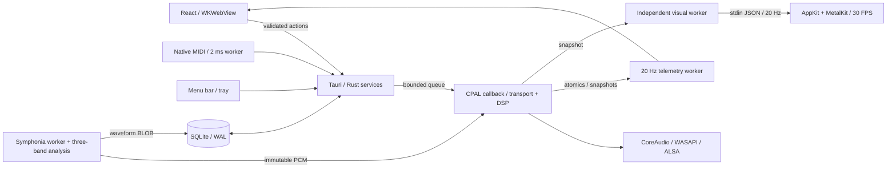

# Architecture and contracts

## Main flow

## Ownership and state

| Domain                         | Authority                                | Persistence                            | Frequency                                      |
| ------------------------------ | ---------------------------------------- | -------------------------------------- | ---------------------------------------------- |
| Transport, position, loop, DSP | `Renderer` and six `Deck` instances      | Temporary                              | Per sample/callback                            |
| Commands                       | `EngineHandle`                           | None                                   | Queue of 256; at most 64 consumed per callback |
| Library, favorites, playlists  | SQLite `Database`                        | WAL, foreign keys, schema v3           | On-demand worker                               |
| PCM and waveform               | Symphonia + `analysis`, outside callback | Temporary PCM; waveform BLOB in SQLite | One decode at a time                           |
| Playback queue                 | `playback::Queue`                        | Temporary; one prefetched clip         | 50 ms native worker                            |
| Library selection              | React                                    | Temporary                              | Interaction                                    |
| Keyboard shortcuts             | TypeScript registry, validated in Rust   | SQLite `settings`                      | Interaction                                    |
| MIDI mappings                  | `Midi`                                   | SQLite `settings`                      | Minimal input callback + 2 ms worker           |
| Visible audio state            | Engine snapshot                          | None                                   | 20 Hz; approximate consistency across fields   |
| Visuals                        | Canvas / Swift process                   | None                                   | At most 30 FPS                                 |
| Appearance                     | `theme-store.ts` / `preferences.rs`      | SQLite `settings`, theme v2            | Interaction                                    |
| Keyboard feedback              | `feedback.ts`, direct DOM                | None                                   | Per key, no React render                       |

Telemetry never causes the UI to re-emit an action. No PCM crosses IPC. Library UI is separate from telemetry consumers. Slider parameters coalesce for 16 ms; transport goes directly. Focused hotkeys follow DOM → IPC → Rust queue without waiting for React. They are not sample accurate; MIDI bypasses the WebView. Web Animations illuminate `data-action`/`data-key` controls, keycaps and the HUD in the input handler, without reading layout or awaiting the engine.

Mix offers classic and console presentations. `HardwareConsole` renders a separate hardware-inspired layout but uses the same native actions, snapshots and shared controls. Each deck has a temporary local HOT CUE/SAMPLER presentation mode: the same pad positions address that deck's three cues or the four global sample slots, with no native mode or audio command on switching. A selected library ID can load an empty sample pad or replace one with Shift-click. Existing keyboard/MIDI actions continue regardless of the visible pad mode. Per-deck curado effects and musical controls sit below the pads, linked transport is in A, and a keyboard map with action feedback is in B. The full mixer remains expandable. Unavailable reference controls have `aria-disabled` and no audio action. `curado.mix-layout.v1` stores only the layout choice in frontend localStorage, with a classic fallback if unavailable or invalid. Switching it does not send a session-mode command or change transport. A resize observer fits the fixed-proportion console to the available sheet width and initial height using CSS zoom; at the 65% minimum it falls back to scrolling rather than shrinking controls indefinitely. This affects presentation only. It is not a hardware or DSP emulation; see [Mixer views](MIXER-VIEWS.md).

`ContextHelp` delegates `pointerover` and `focusin` once per mount, not `pointermove`. `hints.ts` resolves exact actions/current mappings and derives transport/routing diagnostics from snapshots. Help never controls audio, extrapolates position or writes preferences. Unspecified controls use their label/title and fallback text. Its fixed footer row expands the shell's reserved height and repositions notices.

## Waveform and UI rendering

`analysis::WaveformBuilder` consumes each decoded frame without a second pass: 50 bins/s, each `[peak, low, mid, high]` as linear `u8`, using one-pole splits at the EQ's 220/2600 Hz. `analysis::encode` prepends `[1, 50, 0, 0]`; SQLite stores the BLOB (~48 KB for four minutes), returned by `track_waveform` as raw `ArrayBuffer` via `tauri::ipc::Response`, not JSON.

`get_library` excludes peaks. UI requests only displayed track waveforms, with a bounded 24-track FIFO cache. Pre-v3 tracks have `waveform NULL`; the next deck load fills it through non-overwriting `fill_waveform`, and UI requests it again.

Overview canvas repaints only for data, size or theme changes. Position, played area, loop and cues are DOM overlays using transforms/percentages. Detailed waveform pre-renders at 1 px/bin into 4096 px tiles (WebKit canvas limits); each snapshot uses one `drawImage` per visible tile, with an 8 s window and centered playhead. Platters use `position × 200°` (33⅓ rpm), derived from snapshots rather than a timer. Both remain at 20 Hz; see SESSIONS S2.

## Engine

Slots 0/1 are A/B; 2–9 are one-shots. Each deck uses immutable stereo PCM, fractional position and windowed-sinc interpolation (`resample.rs`). Actions addressing a Beat FX unit use slot 2 for the master unit. Rate multiplies the step. A/B key lock and transposition run in real time, described below. Mono outputs downmix L/R; extra output channels are silent. Files with more than two channels are explicitly rejected.

Outputs 3 and 4, on a device with them, are a cue bus: pre-fader channels marked CUE plus slot 10, the preview, mixed with the main by MIXING. On fewer channels the preview goes to the main at half level. Slots 0/1 are decks, 2–9 samples and 10 the preview.

Signal chain: source → trim and auto gain → Linkwitz-Riley EQ at 220/2600 Hz, out of the path when centered → 24 dB LP/HP, likewise → Sound Color FX → gain → beat echo using output BPM (feedback ≤.55) → channel Beat FX → A/B crossfader, or .5 × sampler level for samples → master Beat FX → master → limiter. Gains, crossfader, EQ, wet and filters are smoothed. `fx.rs` holds the effects and `loudness.rs` the BS.1770 measure taken on the loading worker. Slip keeps a shadow position; reverse, scratch and brake use plain playback instead of the stretcher.

`limiter.rs` is stereo-linked with a 1.5 ms look-ahead, 120 ms release and −1 dBTP ceiling (0.891). A 12-tap Hann-sinc detector reads three positions between samples, and a sliding minimum followed by a box average guarantees the gain has reached a peak's requirement when that peak leaves the delay line. It adds a constant 77 frames at 48 kHz (1.6 ms). Below the ceiling its gain is exactly 1, so it only delays. Buffers are sized at engine creation; non-finite samples become silence. A final clamp stays as a safety net, and `clipped` counts only samples it touched. Snapshots expose `limited` frames and `limiterDb`, a reduction held for 200 ms so 20 Hz telemetry cannot miss a short event.

Transport changes never step the audio or fade the destination's attack. Each deck has a main voice and one outgoing voice, mixed before the EQ with raised-cosine gains that sum to one, so a fade cannot add level.

- **Pre-roll (`preroll_to`):** cues, play and sample retriggers start 3 ms early and reach their target at exact unity gain, so a kick on a cue is intact. This delays that attack by 3 ms relative to the command. Nothing precedes the start of a file, so a target within the first 3 ms plays immediately at full level.
- **Loop boundaries (`wrap_loop`):** the two voices meet exactly at the boundary over 8 ms. The old voice ends at OUT, never reaching the next beat's attack, as the new one reaches IN at unity. This adds no delay. The fade shortens to half of very short loops; a loop with no audio before IN starts there directly while the old voice fades past OUT.
- **Other changes:** seek, nudge and sync alignment land exactly on their target and crossfade over 3 ms. Pause and panic stop the position immediately while real audio fades out. A retrigger during a fade keeps the louder of the two voices.
- **Replaced PCM:** a load moves the old clip to `tail_clip` while the outgoing voice reads it, then returns it through `retired` at a later block, or at once if nothing reads it. Each command retires at most one clip per deck, within the two free slots the callback reserves. Fade lengths and master/crossfader smoothing derive from the sample rate.

Loading retains each slot's FX. A/B reset tempo to 1×, transpose to 0, key lock on and sync off. Loading the master disables follower sync. Device reconfiguration creates a new engine and unloads every slot; failure to create the new output preserves the previous one. Stream errors support manual recovery, not automatic reconnection.

`Cue(i)` atomically jumps and plays that slot; no clip means no start. A saved cue plays exactly where it was stored: quantize never moves it on recall, which later imported cues rely on. Unsaved cues read 0:00 and start at the first grid line, because the current storage cannot tell them apart from a cue saved at 0:00. `SetCue(i)` saves without transport changes. Seek/nudge preserve playing/paused state. A jump outside the loop disables it. With Q on, SET CUE, IN, OUT and beat loops use the nearest beat. Only the tail-fitting of a loop near EOF rounds down, and OUT moves one beat past IN if its nearest beat is not after it. `playBoth`, `pauseBoth`, `cueBoth(i)` use one queue entry and apply to A/B before the first sample of the same block, leaving samples/gains/crossfader/master alone. Player mode blocks them in native and keyboard policy. Individual commands may land in different blocks. Musical sync/deferred cues are separate from explicitly linked block-boundary transport.

## Musical analysis and control

`music.rs` analyzes the whole track after decoding, as an additional offline pass separate from waveform construction; `beat.rs` owns the grid, and FFT/chroma/major-minor profiles give the key.

1. **Onsets:** log-energy rise per 5 ms in three bands (below 180 Hz, 180–2200 Hz, above 2200 Hz), each normalized.
2. **Tempo candidates:** an autocorrelation comb over the combined curve, kept to 70–180 BPM. The comb rejects readings that are too fast and phase coherence rejects those too slow. 70–90 and 140–180 BPM can read either way; the fast reading wins through 165 BPM, and beyond that only with a kick on every beat or a clear backbeat.
3. **Exact tempo:** epoch folding. Attacks wrapped onto one period pile up only if the period is right, so a whole track resolves tempo much better than a window. Round tempos win when the audio cannot tell them apart.
4. **Phase:** all bands folded onto one beat. A kick rises in the bass and across the spectrum together, so an off-beat bass note or hi-hat cannot take the grid. A full-rate search around the strongest beats then finds the real start of the attack, and the grid sits 1 ms before it.
5. **Bars:** the first sound and the top of the track are the starting belief; kicks on 1, backbeat energy on 2 and 4 and section changes on a downbeat have to outweigh it. `downbeat` stores a position in seconds, so editing BPM or offset cannot invalidate it. Bars are displayed and editable; sync still works per beat.
6. **First sound:** the first sample within 50 dB of the peak. An unsaved cue starts there, on the grid with Q.

`bpmConfidence` is `1 − 1/folding`, how clearly attacks pile up. It is the track's own evidence, not a probability, and it does separate right from wrong tempos against stored grids (see [Status](STATUS.md)). No BPM is reported without level movement over 200 ms, a pulse standing out from other tempos and minimum folding. There is one constant grid per track: variable tempo gets a low confidence rather than a dynamic grid. Modulation is not detected.

**Timeline:** decoding deliberately keeps encoder delay. Against stored grids, rekordbox's MP3 timeline includes it, so curado's positions match rekordbox's directly; trimming with Symphonia's gapless option moved grids about 25 ms away from them. `first_sound` skips that silence for cues.

Versioned analysis with a manual flag lives in `settings["music:<id>"]`, without a schema-v3 migration. Library data includes it optionally; a track's estimate is recalculated on load or reanalysis when older than `ANALYSIS_VERSION`, so listings show the older BPM until then. Loading preserves saved corrections. Editing accepts registered IDs and validated values, saves to SQLite and updates metadata for every renderer slot holding the track. Original tags are never written.

`bun run music:eval` compares the analysis with the grids rekordbox stored on this machine, reading `ANLZ0000.DAT` and never `master.db`, and prints aggregates without titles or paths. A hash splits tracks into `dev` for tuning and `holdout` for reporting. rekordbox is a reference, not ground truth; its local analysis files carry no cues and only a file name, so audio is found by unique name. A USB export does carry cues, and `real_bars_against_hot_cues` compares bars with them.

Each deck starts with Q enabled and has beat-loop length and sync state. Master guides tempo/phase; follower derives rate from both BPMs. Tempo changes apply in the block they arrive, with or without key lock. Sync never starts transport.

Phase alignment moves a playing follower to the nearest matching beat. It happens once per triggering event, with no continuous correction, so a grid error still drifts. Nudges and pauses do not trigger it, so a nudge on either deck changes the relative phase until the next realignment. A paused follower keeps the position it was given and aligns when it starts. With SYNC+Q, follower cues start their pre-roll per sample so they land on the next master beat, on the nearest grid line of the follower so phase holds; the saved cue is unchanged. Follower pause, panic, linked transport, mode/master/metadata/load changes cancel pending cues. Master EOF also cancels waiting cues. There is no JS musical clock.

## Real-time key lock

`pitch.rs` runs **signalsmith-stretch =0.1.3 (MIT)** inside the callback for A and B. This reverses ADR-014 because the measurements allow it: `process`, `seek`, `reset` and the transpose setters allocate nothing after creation, confirmed for C++ on macOS with the system allocator's logging hook. A deck uses it only with key lock and a tempo at least 0.05 % from the original, or with a transposition; otherwise it plays PCM directly, and moving between the two crossfades at the same position. Samples never use it.

- **No added delay:** the processor needs about 85 ms of audio ahead of its output. PCM is in memory, so a voice reads that far ahead of the deck's position. Position stays the engine's, and attacks stay within about 1 ms of it at ±6 %, 2.5 ms at +20 %.
- **Exact key lock:** the file is resampled to the output rate before processing, so a file at another sample rate needs no transposition, which is the less exact operation. Key lock alone measured 0 cents on tones from 55 Hz to 3.5 kHz at +6 %.
- **Transposition:** sharp by up to about 15 cents at 110–220 Hz, 73 cents on a pure 55 Hz tone at −12 semitones and under 5 cents from 440 Hz. The window is 4096 at 48 kHz, scaled with the sample rate: 2048 kept no more of the attack and doubled this error.
- **Jumps:** each deck has two voices, so a cue or loop fades between old and new while both stay pitched. Starting a voice resets it, seeks and renders half a window silently, because overlap needs that long to be complete; the first audible sample is then within 0.2 dB. Loops use the same mechanism as direct playback, and several jumps in one block cost one start.
- **Cost, offline at 48 kHz/256 frames:** 70–140 µs per callback per pitched deck, peaks of 0.25 ms per chunk and about 1 ms per start. Two simultaneous starts need buffers of about 128 frames or more on this Mac.

Echo preallocates 8 s per slot (~18 MiB for six slots at 48 kHz), covering up to two beats across the tempo range. HP/LP, wet and delay time are smoothed; changing echo time may sweep pitch. HP adds no buffering. Transient/spectral quality and the loop and limiter fades need real listening/corpus validation.

## Memory and real time

- Tracks stay fully in RAM by design: nothing in the callback depends on a disk or USB stick, so a slow or unplugged drive cannot cause a dropout, and a seek is always instant. An hour-long MP3 took 5.1 s to decode and analyze on this Mac.
- `memory.rs` limits decoded PCM to **3 GiB** across all live clips, including queue prefetch and clips awaiting reclamation, and to 2 GiB per track, about 90 minutes at 48 kHz. Each minute takes about 21 MiB. Decoding stops with an explanation when a track would not fit, and allocation failures are errors rather than aborts. Analysis adds about 215 MiB temporarily on an hour-long track. UI and WebKit memory are separate.
- At most two pending loads. Decoding serializes, but imports release the gate per file, so a load waits for one track at most. A newer load for a slot cancels the older one at its next packet, and `load_track` reports that it was replaced.
- Loads create PCM outside callback. Replacement moves the old reference into `retired` (capacity 256), after its fade if it was still audible; a worker reclaims every 50 ms.
- A full reclamation queue pauses command consumption until space returns; queues do not grow.
- No DB, filesystem, locks, logging, Tauri events or buffer allocation in callback. DSP, delay and pitch buffers are prepared at engine creation.
- Atomic snapshots are best effort; 20 Hz telemetry is not a musical sync clock.

## Queue and modes

“Escuchar selección” sends filtered IDs in playlist/library order. After observing playback, the worker detects EOF, decodes the next track and sends load/play. Loading can leave a gap: not gapless. Manual A load cancels queue; normal pause preserves it; panic/mode change cancel it. Repeat modes: off/one/all.

Player uses A with crossfader left and pauses B/samples on entry. Mix centers the crossfader. Rust owns and persists mode, filtering UI/keyboard/MIDI identically. One audio command applies crossfader/pauses together. Mode changes must not recreate the device.

## Library and security

Native file/folder pickers. Recursive import does not follow symlinks, caps batches at 2000 files, validates by decoding and returns at most 30 individual error messages. Paths are canonicalized/deduplicated. Originals never move or get deleted. Loads take registered library IDs, not JS paths. No video tags or native remote streaming.

SQLite tables: `tracks`, `playlists`, `playlist_tracks`, `settings`; foreign keys and cascades remove relationships only. Initial schema creation is transactional and rejects future versions. v1→v2 preserves IDs/playlists/favorites, checks relationships and uses AUTOINCREMENT to prevent ID reuse. v2→v3 transactionally adds `tracks.waveform BLOB`; legacy `peaks` writes `'[]'`. v4+ is rejected without modification. Future migrations must preserve references and test rollback/backup.

Trusted frontend has local CSP, no remote scripts or generic shell/file API. Fonts are bundled; client-generated dither `data:` PNGs are allowed by `img-src`. Window permissions cover drag/theme/background and mini `set-size`, `set-min-size`, `set-always-on-top`; no generic window/WebView creation permission. Rust validates app commands. Codec fuzzing, dependency audit and malicious-file task limits remain pending.

## MIDI and visuals

midir uses CoreMIDI/WinMM/ALSA. Input callback copies three bytes into a queue of 256. Worker handles at most 64 messages every 2 ms, learns device/channel/type/number and sends the same engine actions. CC normalizes parameters (EQ 0–2, unity at CC 64); buttons trigger on Note On or CC ≥64. No MIDI Clock, relative encoders, SysEx or feedback yet.

Metal is a separate process. The visual worker requests one preallocated 2,048-sample mono master capture at a time only while the helper exists. The callback fills it over multiple blocks and publishes through bounded atomics without waiting or allocating; request IDs reject cancelled captures. The worker applies a Hann window and FFT into 24 logarithmic 40 Hz–16 kHz display bins, smooths attack/release, and sends bins with RMS, peak, a 64-sample scope and accent through stdin at up to 20 Hz. Captures are short windows, not full PCM; a blocked pipe stalls only the visual worker and leaves at most one capture pending. The spectrum is approximate, not calibrated metering; mono downmix can cancel anti-phase stereo. Resolution is sample-rate/2048 (23.4 Hz at 48 kHz), with lower bins sharing FFT coefficients; effective updates may be slower than 20 Hz because capture spans callbacks.

The helper provides terrain, orbit, tunnel, ribbons, a faceted gateway, circular scope and a depth-tested low-poly spectral city. Controls for scene, glow, sensitivity, speed and color are temporary; H hides/restores controls, F toggles native fullscreen and R resets the spring camera. Dragging the visual moves its camera, then it springs back. Not every setting affects every scene: glow is procedural and applies to the screen shaders, not terrain or city, and is not a post-processing bloom. Drawing is bounded to 30 FPS and hidden/minimized skips drawing, though capture continues while the helper exists. The helper exits on window close/stdin close. Distribution requires replacing extraction with a signed in-bundle helper.

## Camera tracking

`native/CuradoTracker.swift` is a separate process: AVFoundation at 640×480, Vision at most 15 times a second, and JSON lines on its output. `tracking.rs` supervises it and passes checked frames as `tracking:frame`. `lib/tracking.ts` steadies them into points for the XY surfaces, which use the same moves as a finger. It never touches the audio path.

## Connected devices and rekordbox

`devices.rs` lists mounted drives every 2 s on its own worker, without holding locks while it asks, because a dead network drive can take long to answer. `rekordbox.rs` reads `PIONEER/rekordbox/export.pdb` and `ANLZ` files with no new dependency, based on the formats documented by Deep Symmetry's Crate Digger. `exportLibrary.db` (OneLibrary) is ignored: it is encrypted, and the unencrypted export has the same library.

- **Read only:** nothing opens a device file for writing, and a contract test enforces it. Edits stay in curado's database. Writing to a USB does not exist; `rekordbox_xml.rs` writes a `rekordbox.xml` only to the file chosen in a native dialog.
- **Export:** `plan` reads the library under its lock and decides what goes in; `export` then searches for originals of edited USB tracks, renders and replaces the file atomically, outside any lock. No XML dependency: the writer escapes attributes and tests check its text, and `real_xml` writes a file from a real USB for external validators. Rules and reasons in ADR-021.
- **Untrusted input:** every read is bounds-checked, page chains are bounded, files are size-limited and tests feed truncated and corrupted data. A malformed file gives an error or less data, never a panic.
- **No paths through IPC:** the interface sends a device name, a rekordbox track id or an opaque folder entry. Native code resolves them and rejects anything outside the drive after following links, or that is not supported audio. Browsing shows only audio files and folders with audio inside, never follows links, and skips hidden and system folders.
- **Registration:** loading a device track registers it by path in `tracks` with no schema change, plus `settings["device-only:<id>"]`, which keeps it out of the library's lists. A track already in the library stays there, and importing a file on purpose clears the mark. `device-track:<id>` records what the last import brought.
- **What is imported, once per analysis file version:** BPM, grid start, first bar, key, eight hot cues with loop ends, colors and comments, and memory cues. Positions need no conversion because curado's timeline matches rekordbox's. A variable grid keeps its median tempo, since curado has one grid per track. A new export updates a track unless it was edited here: `manual` protects its grid, and cues differing from the last import are kept.
- **Pulled drives:** PCM is in RAM, so a loaded track keeps playing. Its view closes, and loading it again gives an ordinary error.

Hot cue positions and ends live in `cues:<id>` and `cue-ends:<id>`. Older three-position arrays still read. `cue-info:<id>` holds colors, comments and memory cues for the interface only, so it never reaches the callback. Keyboard defaults still cover cues 1–3; pads and MIDI Learn reach all eight.

## Isolated web services

`web.rs` creates a child WebView in main via Tauri's unstable `Window::add_child`, using fixed fractos/SoundCloud URLs. React reserves its area and syncs logical bounds through ResizeObserver/resize/scroll; Rust rejects negative/nonfinite/empty/oversized rectangles. Serialized React operations and an independent native gate do not touch audio. Switching service or unmounting (library/mini) closes it. Settings/playlist dialogs only hide it temporarily while playback continues. Web audio bypasses engine/panic.

HTTPS exact-host policy includes widgets; incognito, popups/downloads denied. No script injection or PCM bridge. `app_commands.rs` registers every app command in AppManifest to generate permissions. Capability selects only **webview main**, omitting `windows` (which would grant its children permissions too). Handler additionally rejects other labels. Local CSP/core permissions unchanged, no remote grants or generic JS creation. Tray/single-instance use Window, since WebviewWindow no longer represents main while children exist. Tests cover permission selection/wiring/URLs/bounds, not real layout/focus/player compatibility. See ADR-012.

## Persistent cues, modes and themes

Clips share track `CueState`: eight positions and loop ends plus atomic revision. Saving a cue allocates nothing and performs no IO; callback updates seconds. Both decks share cues for the same track. Independent `curado-autosave` worker (50 ms) saves changed `settings["cues:<id>"]`, marks saved revision only after success, retries failures and publishes `persistenceError`. Normal shutdown flushes. Loops/session positions remain temporary.

Within 15 s of EOF, prefetch worker decodes next track under `decode_gate` without holding queue/output, storing `Queue::prefetched`. `advance` uses it if ID matches. Repeat-one seeks to 0. Stopping queue releases the clip on the worker. Gap becomes roughly one tick (≤50 ms) plus callback acknowledgement, still not gapless; at most one extra clip, inside the same limit.

`load_track` waits for callback ticket acknowledgement before reporting ready, with a two-second timeout/recoverable error if output is not processing. Enqueueing PCM alone is not success; demo pads cannot appear ready under backpressure prematurely.

Queue `load_and_play` occupies one entry with one load ticket and applies before the block's first sample. Repeat-one uses one `Trigger`, not separate seek/play. Prefetch jobs carry queue revision plus ID; old successes/errors are discarded even when a new session has identical IDs. Failed prefetch is suppressed for that upcoming ID, with one final attempt on advance; failure then stops queue. Restart resets policy. Manual loads stay paused and retain acknowledgement.

SQLite persists mode. `SetMode` is one renderer command. `session.rs` allows A transport/FX, master/panic/pauses in player, blocking B/sample playback even through MIDI. Device changes reapply mode. Versioned/validated theme preferences do not affect audio; see THEMES.

Service lock order, never callback: decode gate → mode → queue → output when needed together; annotations → DB. Do not hold service locks while emitting events. Snapshot reads each service in a separate statement to drop guards; never acquire mode while holding queue. Decode holds neither mode nor output. Autosave does not share the telemetry thread.
