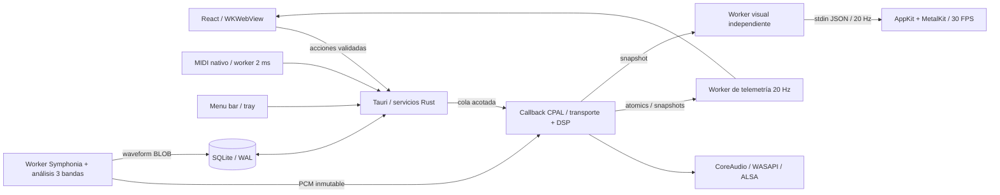

# Arquitectura y contratos

## Flujo principal

## Responsabilidad y estado

| Dominio                          | Autoridad                                 | Persistencia                          | Frecuencia                                     |
| -------------------------------- | ----------------------------------------- | ------------------------------------- | ---------------------------------------------- |
| Transporte, posición, loop, DSP  | `Renderer` y sus seis `Deck`              | Temporal                              | Por muestra y por callback                     |
| Comandos                         | `EngineHandle`                            | Sin persistencia                      | Cola de 256; máximo 64 consumidos por callback |
| Biblioteca, favoritos, playlists | SQLite `Database`                         | WAL, FK, esquema v3                   | Worker bajo demanda                            |
| PCM y waveform                   | Symphonia + `analysis` fuera del callback | PCM temporal; waveform BLOB en SQLite | Una decodificación a la vez                    |
| Cola de escucha                  | `playback::Queue`                         | Temporal; 1 clip de prefetch          | Worker nativo 50 ms                            |
| Selección de biblioteca          | React                                     | Temporal                              | Interacción                                    |
| Atajos de teclado                | Registro TypeScript validado en Rust      | SQLite `settings`                     | Interacción                                    |
| Mapeos MIDI                      | `Midi`                                    | SQLite `settings`                     | Input callback mínimo + worker 2 ms            |
| Estado visible                   | Snapshot del motor                        | Ninguna                               | 20 Hz, consistencia aproximada entre campos    |
| Visuales                         | Canvas / proceso Swift                    | Ninguna                               | Render máximo 30 FPS                           |
| Apariencia                       | `theme-store.ts` / `preferences.rs`       | SQLite `settings` (tema v2)           | Interacción                                    |
| Feedback de teclado              | `feedback.ts` (DOM directo)               | Ninguna                               | Por tecla, sin render de React                 |

La UI no vuelve a emitir una acción al recibir telemetría; no hay bucles de realimentación de estado. No se transmite PCM por IPC. La UI de biblioteca está separada de consumidores de telemetría. Los parámetros de sliders se agrupan durante 16 ms; transporte se envía directamente. Los hotkeys enfocados pasan por DOM → IPC → cola Rust, sin esperar un render de React. No son sample accurate; MIDI evita el WebView. El feedback visual de una tecla (control iluminado, keycap y HUD) se dispara en el mismo handler mediante Web Animations sobre `data-action`/`data-key`; no lee layout ni espera respuesta del motor.

## Waveform y render de la UI

`analysis::WaveformBuilder` se alimenta frame a frame durante la decodificación (sin segunda pasada): 50 bins por segundo, cada bin `[peak, low, mid, high]` en `u8` lineal, con los mismos cortes de un polo que el EQ (220/2600 Hz) para que el color corresponda a lo que mueven las perillas. `analysis::encode` añade la cabecera `[1, 50, 0, 0]`; SQLite guarda ese BLOB (≈48 KB por pista de 4 min) y el comando `track_waveform` lo devuelve como `ArrayBuffer` crudo (`tauri::ipc::Response`), sin JSON.

`get_library` ya no transporta peaks: la lista escala con bibliotecas grandes. La UI pide la waveform por pista (caché acotada de 24 pistas, FIFO) solo cuando un deck/reproductor la muestra. Pistas importadas antes de v3 tienen `waveform NULL`; la siguiente carga en un deck la calcula (`fill_waveform`, nunca sobrescribe) y la UI la vuelve a pedir.

Contrato de render: la vista general se dibuja en canvas solo al cambiar datos, tamaño o tema; posición, zona reproducida, loop y cues son overlays DOM movidos con `transform` o porcentajes. La vista detallada pre-renderiza la pista a 1 px/bin en tiles de 4096 px (límites de canvas de WebKit) y en cada snapshot hace un `drawImage` por tile visible, con el playhead fijo al centro y ventana de 8 s. Los platos giran con `posición × 200°` (33⅓ rpm) derivado del snapshot, no de un timer. Todo sigue a 20 Hz; ver SESSIONS S2 para fluidez.

## Motor

Slots 0 y 1 son decks A/B; 2–5 son one shots. Cada deck usa PCM estéreo inmutable, posición fraccionaria y conversión de sample rate con interpolación lineal. Rate multiplica el paso; no hay separación de pitch/tempo. Mezcla L/R; en dispositivos mono se hace downmix; canales adicionales reciben silencio. Los archivos con más de dos canales se rechazan expresamente.

Cadena: fuente → EQ por splits de un polo a 220/2600 Hz → filtro LP → ganancia → echo de 375 ms (feedback máximo .55) → crossfader para A/B, ganancia .5 para samples → master → clamp ±.98. El techo evita valores fuera de escala, pero puede distorsionar; **no es un limitador mastering**. Ganancias, crossfader, EQ, wet y filtro se suavizan; transportes manuales tienen transición de 128 frames. Los límites de loop aún pueden producir discontinuidades.

Cada slot conserva su DSP al cargar otra pista. Un cambio de dispositivo crea otro motor y descarga todos los slots. Si crear la nueva salida falla, se conserva la anterior. Los errores de stream se publican para recuperación manual; no hay reconexión automática.

## Memoria y tiempo real

- PCM máximo 96 MiB por clip; seis residentes hasta 576 MiB, sin contar UI, transitorios o retirados.
- Máximo dos cargas pendientes en la cola. La importación y cargas se serializan; una importación grande puede retrasar nuevas cargas, sin bloquear el audio que ya suena.
- Cada carga crea PCM fuera del callback. Al sustituirlo, la referencia vieja pasa a `retired` (capacidad 256); un worker libera memoria cada 50 ms.
- Si reclamación se llena, el renderer deja de consumir comandos hasta que se vacíe. La cola no crece.
- Las colas acotadas establecen límites, pero aún no hay un presupuesto global estricto de memoria. Streaming y reclamación con límite de bytes son P0.
- Sin DB, filesystem, locks, logging, eventos Tauri o asignación de buffers en el callback. DSP y buffers de delay se preparan al crear el motor.
- Snapshot best effort mediante atomics; no usar la telemetría de 20 Hz como reloj de sincronización musical.

## Cola, modos y efectos relacionados

«Escuchar selección» envía los IDs filtrados en el orden de la playlist/biblioteca a Rust. El worker detecta fin después de observar reproducción, decodifica la siguiente pista y manda load/play. Puede haber pausa de carga; no es gapless. Un load manual en A cancela la cola; pausa normal la conserva; pánico y cambio de modo la cancelan. La API y UI permiten repeat off/one/all.

Player usa A y crossfader a la izquierda. Al pasar de mezcla a player se pausan B y samples. Mezcla centra el crossfader. El modo vive en Rust, se persiste y filtra de la misma manera las acciones de UI/teclado/MIDI. Un único comando de audio aplica crossfader y pausas al cambiar de modo. No ligar cambios de modo a reconstruir el dispositivo.

## Biblioteca y seguridad

Los selectores de archivos/carpetas son nativos. Importación recursiva no sigue symlinks y limita a 2000 archivos por lote. Cada archivo se valida decodificándolo; errores individuales vuelven en el informe (máximo 30 mensajes). Las rutas se canonicalizan y deduplican. El original nunca se mueve ni borra. Load acepta ID de biblioteca; no rutas desde JS. No hay tags de video ni streaming remoto.

SQLite `tracks`, `playlists`, `playlist_tracks`, `settings`; claves foráneas y borrado en cascada solo de relaciones. El esquema inicial se crea transaccionalmente y rechaza versiones futuras. La migración v1→v2 conserva IDs, playlists y favoritos, comprueba relaciones y usa AUTOINCREMENT para evitar reutilizar un ID eliminado. v2→v3 añade `tracks.waveform BLOB` en una transacción; la columna `peaks` queda solo por compatibilidad (se escribe `'[]'`). Una base v4+ se rechaza sin modificarla. Migraciones futuras deben preservar referencias y añadir pruebas de rollback/backup.

Tauri mantiene CSP local, sin scripts remotos ni shell/file API genérica expuesta al frontend. Fuentes empaquetadas localmente; las texturas dither son `data:` PNG generados en el cliente (permitidos por `img-src`). Permisos de ventana: arrastre, tema, fondo y, para la vista mini, `set-size`, `set-min-size`, `set-always-on-top`. No se concede creación de webviews/ventanas. Los comandos de aplicación hacen validación en Rust. Falta aún fuzzeo de codecs, auditoría de dependencias y una política de límites para archivos maliciosos.

## MIDI y visuales

CoreMIDI/WinMM/ALSA mediante midir. Callback de MIDI solo copia tres bytes a cola de 256. Worker procesa hasta 64 mensajes cada 2 ms, aprende por dispositivo/canal/tipo/número y envía acciones al mismo motor. CC normaliza parámetros (EQ 0–2 con unidad en CC 64); botones disparan en Note On o CC ≥64. Sin reloj MIDI, encoders relativos, SysEx ni feedback.

Metal vive en otro proceso. La app extrae un helper Swift a su caché; recibe RMS, peak y 64 muestras de scope, nunca PCM completo. Una tubería bloqueada retiene solo al worker visual. Metal dibuja una malla procedural mediante shaders; no hay FFT ni separación real de bandas aún. Minimizado/oculto omite dibujo. El helper termina al cerrar su ventana o al cerrarse stdin. Para distribución firmada se debe reemplazar la extracción por un helper firmado dentro del bundle.

## Cues persistentes, modos y temas

Cada clip comparte un `CueState` por track: tres valores y revisión atómicos. Guardar un cue no asigna memoria ni hace I/O; el callback actualiza segundos en ese estado. Decks que cargan la misma pista comparten sus cues. Un worker independiente (`curado-autosave`, 50 ms) detecta revisiones y guarda en `settings` con clave `cues:<id>`; solo marca revisión guardada después de una escritura exitosa. Si falla, reintenta y publica `persistenceError`. El cierre normal hace un flush. Loops y posiciones de sesión todavía son temporales.

Cola con prefetch: cuando la pista actual está a menos de 15 s del final, el worker decodifica la siguiente (con `decode_gate`, sin retener queue/output) y la guarda en `Queue::prefetched`; al terminar, `advance` la usa si el ID coincide. Repetir pista hace seek a 0 en lugar de redecodificar. Si la cola se desactiva, el clip se suelta en el worker. Reduce el hueco entre pistas a ~un tick (≤50 ms) más la confirmación del callback; sigue sin ser gapless. Coste: hasta un clip extra (≤96 MiB) residente.

Las cargas reciben un ticket. El comando `load_track` espera confirmación del callback antes de responder listo; no basta con haber encolado el PCM. Tiene timeout de dos segundos y error recuperable si la salida no procesa. Esto evita cargas de demo que terminen con pads vacíos bajo backpressure.

El modo nativo se guarda en SQLite; `SetMode` es un comando único al renderer. Política en `session.rs`: player permite transporte/FX de A, master/pánico y pausas, y bloquea reproducción de B/samples incluso por MIDI. Cambiar de dispositivo reaplica el modo. Las preferencias de tema tienen tipo versionado y validación separada; no tocan el audio. Ver THEMES.

Orden de locks de servicios (nunca en callback): cuando se necesitan juntos, decode gate → mode → queue → output; annotations → DB. No mantener locks de servicios al emitir eventos. Snapshot consulta cada servicio en una sentencia separada para liberar guards antes del siguiente; nunca adquirir mode mientras se retiene queue. Decodificar una pista no retiene mode ni output. Autosave no comparte el hilo de telemetría.
