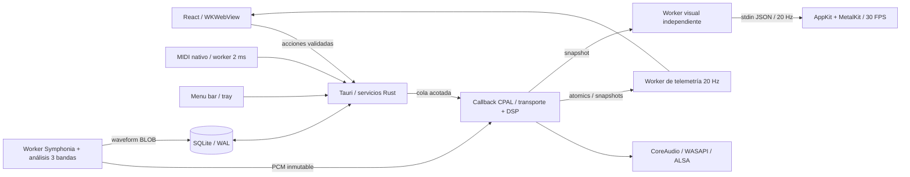

# Arquitectura y contratos

## Flujo principal

## Responsabilidad y estado

| Dominio                          | Autoridad                                 | Persistencia                          | Frecuencia                                     |
| -------------------------------- | ----------------------------------------- | ------------------------------------- | ---------------------------------------------- |
| Transporte, posición, loop, DSP  | `Renderer` y sus seis `Deck`              | Temporal                              | Por muestra y por callback                     |
| Comandos                         | `EngineHandle`                            | Sin persistencia                      | Cola de 256; máximo 64 consumidos por callback |
| Biblioteca, favoritos, playlists | SQLite `Database`                         | WAL, FK, esquema v3                   | Worker bajo demanda                            |
| PCM y waveform                   | Symphonia + `analysis` fuera del callback | PCM temporal; waveform BLOB en SQLite | Una decodificación a la vez                    |
| Cola de escucha                  | `playback::Queue`                         | Temporal; 1 clip de prefetch          | Worker nativo 50 ms                            |
| Selección de biblioteca          | React                                     | Temporal                              | Interacción                                    |
| Atajos de teclado                | Registro TypeScript validado en Rust      | SQLite `settings`                     | Interacción                                    |
| Mapeos MIDI                      | `Midi`                                    | SQLite `settings`                     | Input callback mínimo + worker 2 ms            |
| Estado visible                   | Snapshot del motor                        | Ninguna                               | 20 Hz, consistencia aproximada entre campos    |
| Visuales                         | Canvas / proceso Swift                    | Ninguna                               | Render máximo 30 FPS                           |
| Apariencia                       | `theme-store.ts` / `preferences.rs`       | SQLite `settings` (tema v2)           | Interacción                                    |
| Feedback de teclado              | `feedback.ts` (DOM directo)               | Ninguna                               | Por tecla, sin render de React                 |

La UI no vuelve a emitir una acción al recibir telemetría; no hay bucles de realimentación de estado. No se transmite PCM por IPC. La UI de biblioteca está separada de consumidores de telemetría. Los parámetros de sliders se agrupan durante 16 ms; transporte se envía directamente. Los hotkeys enfocados pasan por DOM → IPC → cola Rust, sin esperar un render de React. No son sample accurate; MIDI evita el WebView. El feedback visual de una tecla (control iluminado, keycap y HUD) se dispara en el mismo handler mediante Web Animations sobre `data-action`/`data-key`; no lee layout ni espera respuesta del motor.

`ContextHelp` delega `pointerover` y `focusin` una vez por montaje; no atiende `pointermove`. `hints.ts` resuelve la acción exacta, consulta los mapeos actuales y deriva diagnósticos de transporte/routing desde snapshots. La ayuda no controla audio, no extrapola posición y no escribe preferencias. Los controles sin descripción específica reciben etiqueta/título y texto de base. El panel permanece en la fila fija del footer; su expansión cambia la altura reservada del shell y del área de avisos.

## Waveform y render de la UI

`analysis::WaveformBuilder` se alimenta frame a frame durante la decodificación (sin segunda pasada): 50 bins por segundo, cada bin `[peak, low, mid, high]` en `u8` lineal, con los mismos cortes de un polo que el EQ (220/2600 Hz) para que el color corresponda a lo que mueven las perillas. `analysis::encode` añade la cabecera `[1, 50, 0, 0]`; SQLite guarda ese BLOB (≈48 KB por pista de 4 min) y el comando `track_waveform` lo devuelve como `ArrayBuffer` crudo (`tauri::ipc::Response`), sin JSON.

`get_library` ya no transporta peaks: la lista escala con bibliotecas grandes. La UI pide la waveform por pista (caché acotada de 24 pistas, FIFO) solo cuando un deck/reproductor la muestra. Pistas importadas antes de v3 tienen `waveform NULL`; la siguiente carga en un deck la calcula (`fill_waveform`, nunca sobrescribe) y la UI la vuelve a pedir.

Contrato de render: la vista general se dibuja en canvas solo al cambiar datos, tamaño o tema; posición, zona reproducida, loop y cues son overlays DOM movidos con `transform` o porcentajes. La vista detallada pre-renderiza la pista a 1 px/bin en tiles de 4096 px (límites de canvas de WebKit) y en cada snapshot hace un `drawImage` por tile visible, con el playhead fijo al centro y ventana de 8 s. Los platos giran con `posición × 200°` (33⅓ rpm) derivado del snapshot, no de un timer. Todo sigue a 20 Hz; ver SESSIONS S2 para fluidez.

## Motor

Slots 0 y 1 son decks A/B; 2–5 son one shots. Cada deck usa PCM estéreo inmutable, posición fraccionaria y conversión de sample rate con interpolación lineal. Rate multiplica el paso. En A/B, transposición y key lock se preparan sobre PCM de igual duración en un worker; ver el contrato musical. Mezcla L/R; en dispositivos mono se hace downmix; canales adicionales reciben silencio. Los archivos con más de dos canales se rechazan expresamente.

Cadena: fuente → EQ por splits de un polo a 220/2600 Hz → filtros LP/HP → ganancia → echo en beats según BPM de salida (feedback máximo .55) → crossfader para A/B, ganancia .5 para samples → master → clamp ±.98. El techo evita valores fuera de escala, pero puede distorsionar; **no es un limitador mastering**. Ganancias, crossfader, EQ, wet y filtro se suavizan; transportes manuales tienen transición de 128 frames. Los límites de loop aún pueden producir discontinuidades.

Cada slot conserva sus FX al cargar otra pista; A/B reinician tempo a 1×, transposición a 0 y key lock activo, y desactivan su sync. Cargar el master desactiva el seguimiento del otro deck. Un cambio de dispositivo crea otro motor y descarga todos los slots. Si crear la nueva salida falla, se conserva la anterior. Los errores de stream se publican para recuperación manual; no hay reconexión automática.

`Cue(i)` es un salto + reproducción atómico por slot (sin clip no inicia). `SetCue(i)` guarda sin cambiar el transporte. Seek y nudge conservan reproducción/pausa. Un salto fuera del loop desactiva su repetición para evitar que el siguiente frame vuelva a otro tramo. `playBoth`, `pauseBoth` y `cueBoth(i)` son una sola entrada de la cola, aplicadas únicamente a A/B antes de renderizar el bloque; no modifican samples, ganancias, crossfader ni master. El modo player bloquea estas acciones en la política nativa y en teclado. Dos comandos individuales pueden caer en bloques distintos; usar la acción conjunta cuando se necesite el mismo límite de bloque. La política musical añade sync y cues diferidos al siguiente beat; el transporte conjunto sigue siendo una operación explícita en el límite de bloque.

## Análisis y control musical

`music.rs` analiza un máximo de 90 s tras decodificar: envolvente de ataques, autocorrelación y ajuste de periodos para BPM/offset; FFT, chroma y perfiles mayor/menor para tonalidad. Es un pase offline adicional, distinto del análisis de waveform en la decodificación. No identifica compases/downbeats, tempo variable ni modulaciones. Los indicadores de periodicidad/margen no son probabilidades calibradas. Silencio o evidencia insuficiente pueden devolver valores desconocidos.

El análisis se guarda como `settings["music:<id>"]` con versión y bandera manual, sin migrar el esquema v3. La biblioteca lo lista opcionalmente; pistas antiguas lo calculan al cargar o al reanalizar. Cargar usa el análisis guardado y no sobrescribe correcciones. Los comandos de edición aceptan IDs registrados y valores validados, guardan en SQLite y envían metadata al renderer para todos los slots con esa pista. No se escriben tags en los archivos.

Cada deck tiene Q activo por defecto, tamaño de loop en beats y estado sync. El master guía tempo y fase; el follower deriva rate de ambos BPM. Los cambios de tempo con key lock esperan la preparación; si ambos necesitan PCM, una sola entrada aplica el lote antes del bloque. El sync no arranca transportes. Cues del follower con SYNC+Q se difieren en el renderer hasta cruzar el siguiente beat del master, por muestra; el resto de transportes manuales reevalúa la fase. Pausa explícita del follower, pánico, transporte conjunto, cambio de modo/master/metadata/carga cancelan cues pendientes; un master que termina también cancela la espera. No hay reloj musical JS.

`curado-tuning` conserva hasta dos fuentes originales y prepara hasta dos resultados con **signalsmith-stretch =0.1.3 (MIT)**. Factor = `2^(semitones/12) / rate` con key lock; sin key lock, `2^(semitones/12)`. El resultado mantiene sample rate y cantidad de frames; se descartan ambas mitades de latencia del procesador. CPP/FFT y asignaciones viven exclusivamente en ese worker. Los controles rápidos se agrupan durante 100 ms antes de reservar PCM; el procesamiento comprueba cancelación por bloques. Sigue sonando la configuración anterior hasta que la nueva esté lista.

Los lotes llevan ticket de carga y revisión de tuning; incluso recargar el mismo ID invalida trabajos viejos. El callback valida todo el lote y retira tanto clips sustituidos como rechazados. Reserva al menos dos lugares libres en `retired`; nunca libera PCM allí. Un ack se publica al terminar el bloque, incluyendo lotes descartados: el worker puede reintentar una petición aún vigente sin quedar bloqueado por una revisión anterior. Fallos de preparación se muestran y tienen reintento explícito. Un cambio de salida cancela trabajos mediante generación. La instalación del PCM conserva posición, play/pausa, cues y FX.

Coste añadido: hasta **192 MiB** de fuentes originales en caché y **192 MiB** de resultados preparados, además de los clips/retirados ya descritos. No es un presupuesto global de memoria ni una solución de streaming. Los delay lines de echo se preasignan para 8 s por slot (~18 MiB para seis slots a 48 kHz); cubren las divisiones hasta dos beats en todo el rango de tempo. HP/LP, wet y tiempo de delay se suavizan; cambiar tiempo de echo puede producir un barrido de pitch. HP no añade buffering. La calidad espectral/transitoria de transposición y los límites de loop aún requieren escucha y corpus real.

## Memoria y tiempo real

- PCM máximo 96 MiB por clip; seis residentes hasta 576 MiB, sin contar UI, transitorios o retirados.
- Máximo dos cargas pendientes en la cola. La importación y cargas se serializan; una importación grande puede retrasar nuevas cargas, sin bloquear el audio que ya suena.
- Cada carga crea PCM fuera del callback. Al sustituirlo, la referencia vieja pasa a `retired` (capacidad 256); un worker libera memoria cada 50 ms.
- Si reclamación se llena, el renderer deja de consumir comandos hasta que se vacíe. La cola no crece.
- Las colas acotadas establecen límites, pero aún no hay un presupuesto global estricto de memoria. Streaming y reclamación con límite de bytes son P0.
- Sin DB, filesystem, locks, logging, eventos Tauri o asignación de buffers en el callback. DSP y buffers de delay se preparan al crear el motor.
- Snapshot best effort mediante atomics; no usar la telemetría de 20 Hz como reloj de sincronización musical.

## Cola, modos y efectos relacionados

«Escuchar selección» envía los IDs filtrados en el orden de la playlist/biblioteca a Rust. El worker detecta fin después de observar reproducción, decodifica la siguiente pista y manda load/play. Puede haber pausa de carga; no es gapless. Un load manual en A cancela la cola; pausa normal la conserva; pánico y cambio de modo la cancelan. La API y UI permiten repeat off/one/all.

Player usa A y crossfader a la izquierda. Al pasar de mezcla a player se pausan B y samples. Mezcla centra el crossfader. El modo vive en Rust, se persiste y filtra de la misma manera las acciones de UI/teclado/MIDI. Un único comando de audio aplica crossfader y pausas al cambiar de modo. No ligar cambios de modo a reconstruir el dispositivo.

## Biblioteca y seguridad

Los selectores de archivos/carpetas son nativos. Importación recursiva no sigue symlinks y limita a 2000 archivos por lote. Cada archivo se valida decodificándolo; errores individuales vuelven en el informe (máximo 30 mensajes). Las rutas se canonicalizan y deduplican. El original nunca se mueve ni borra. Load acepta ID de biblioteca; no rutas desde JS. No hay tags de video ni streaming remoto.

SQLite `tracks`, `playlists`, `playlist_tracks`, `settings`; claves foráneas y borrado en cascada solo de relaciones. El esquema inicial se crea transaccionalmente y rechaza versiones futuras. La migración v1→v2 conserva IDs, playlists y favoritos, comprueba relaciones y usa AUTOINCREMENT para evitar reutilizar un ID eliminado. v2→v3 añade `tracks.waveform BLOB` en una transacción; la columna `peaks` queda solo por compatibilidad (se escribe `'[]'`). Una base v4+ se rechaza sin modificarla. Migraciones futuras deben preservar referencias y añadir pruebas de rollback/backup.

Tauri mantiene CSP local, sin scripts remotos ni shell/file API genérica expuesta al frontend. Fuentes empaquetadas localmente; las texturas dither son `data:` PNG generados en el cliente (permitidos por `img-src`). Permisos de ventana: arrastre, tema, fondo y, para la vista mini, `set-size`, `set-min-size`, `set-always-on-top`. No se concede creación de webviews/ventanas. Los comandos de aplicación hacen validación en Rust. Falta aún fuzzeo de codecs, auditoría de dependencias y una política de límites para archivos maliciosos.

## MIDI y visuales

CoreMIDI/WinMM/ALSA mediante midir. Callback de MIDI solo copia tres bytes a cola de 256. Worker procesa hasta 64 mensajes cada 2 ms, aprende por dispositivo/canal/tipo/número y envía acciones al mismo motor. CC normaliza parámetros (EQ 0–2 con unidad en CC 64); botones disparan en Note On o CC ≥64. Sin reloj MIDI, encoders relativos, SysEx ni feedback.

Metal vive en otro proceso. La app extrae un helper Swift a su caché; recibe RMS, peak y 64 muestras de scope, nunca PCM completo. Una tubería bloqueada retiene solo al worker visual. Metal dibuja una malla procedural mediante shaders; no hay FFT ni separación real de bandas aún. Minimizado/oculto omite dibujo. El helper termina al cerrar su ventana o al cerrarse stdin. Para distribución firmada se debe reemplazar la extracción por un helper firmado dentro del bundle.

## Servicios web aislados

`web.rs` crea un WebView hijo dentro de la ventana main (`Window::add_child`, feature unstable de Tauri), con URLs fijas de fractos radio y SoundCloud. React reserva el panel y sincroniza bounds lógicos mediante ResizeObserver/resize/scroll; Rust rechaza rectángulos negativos/no finitos/vacíos/desmesurados. Operaciones React serializadas y gate nativo independiente, sin tocar audio. Cambiar servicio o desmontar la vista cierra el hijo: sin audio web oculto al ir a biblioteca/mini. Configuración y diálogo de playlists solo lo ocultan temporalmente, conservando reproducción. El audio web no entra al motor ni responde al pánico local.

Navegación HTTPS por hosts exactos, widgets incluidos; incognito, popups/descargas denegados. Sin inyección ni puente PCM. `app_commands.rs` registra todos los comandos propios en AppManifest; build genera permisos. La capability selecciona exclusivamente el **webview main**, sin `windows`: seleccionar la ventana main otorgaría sus permisos a todos sus hijos. El handler además rechaza otros labels. CSP/permisos core intactos, sin grant remoto ni creación genérica desde JS. Tray/instancia única consultan Window, no WebviewWindow (esta última no representa main cuando tiene hijos). Tests cubren selección de permisos, cableado y política/rectángulos; falta comprobar compatibilidad/layout/foco reales. Ver ADR-012.

## Cues persistentes, modos y temas

Cada clip comparte un `CueState` por track: tres valores y revisión atómicos. Guardar un cue no asigna memoria ni hace I/O; el callback actualiza segundos en ese estado. Decks que cargan la misma pista comparten sus cues. Un worker independiente (`curado-autosave`, 50 ms) detecta revisiones y guarda en `settings` con clave `cues:<id>`; solo marca revisión guardada después de una escritura exitosa. Si falla, reintenta y publica `persistenceError`. El cierre normal hace un flush. Loops y posiciones de sesión todavía son temporales.

Cola con prefetch: cuando la pista actual está a menos de 15 s del final, el worker decodifica la siguiente (con `decode_gate`, sin retener queue/output) y la guarda en `Queue::prefetched`; al terminar, `advance` la usa si el ID coincide. Repetir pista hace seek a 0 en lugar de redecodificar. Si la cola se desactiva, el clip se suelta en el worker. Reduce el hueco entre pistas a ~un tick (≤50 ms) más la confirmación del callback; sigue sin ser gapless. Coste: hasta un clip extra (≤96 MiB) residente.

Las cargas reciben un ticket. El comando `load_track` espera confirmación del callback antes de responder listo; no basta con haber encolado el PCM. Tiene timeout de dos segundos y error recuperable si la salida no procesa. Esto evita cargas de demo que terminen con pads vacíos bajo backpressure.

La cola usa `load_and_play`: carga y arranque ocupan una entrada, comparten el ticket de carga y se aplican antes de la primera muestra del bloque. Repeat-one usa un único `Trigger`, sin el par seek/play. Las tareas de prefetch llevan revisión de cola además del ID: se descartan resultados y errores de una sesión anterior, incluso si la nueva sesión tiene los mismos IDs. Una precarga fallida se suprime para ese próximo ID durante la sesión; al avanzar se permite un último intento y, si falla, la cola se detiene. Reiniciar la cola restablece esa política. La carga manual sigue pausada y conserva su confirmación por callback.

El modo nativo se guarda en SQLite; `SetMode` es un comando único al renderer. Política en `session.rs`: player permite transporte/FX de A, master/pánico y pausas, y bloquea reproducción de B/samples incluso por MIDI. Cambiar de dispositivo reaplica el modo. Las preferencias de tema tienen tipo versionado y validación separada; no tocan el audio. Ver THEMES.

Orden de locks de servicios (nunca en callback): cuando se necesitan juntos, decode gate → mode → queue → output; annotations → DB. No mantener locks de servicios al emitir eventos. Snapshot consulta cada servicio en una sentencia separada para liberar guards antes del siguiente; nunca adquirir mode mientras se retiene queue. Decodificar una pista no retiene mode ni output. Autosave no comparte el hilo de telemetría.
